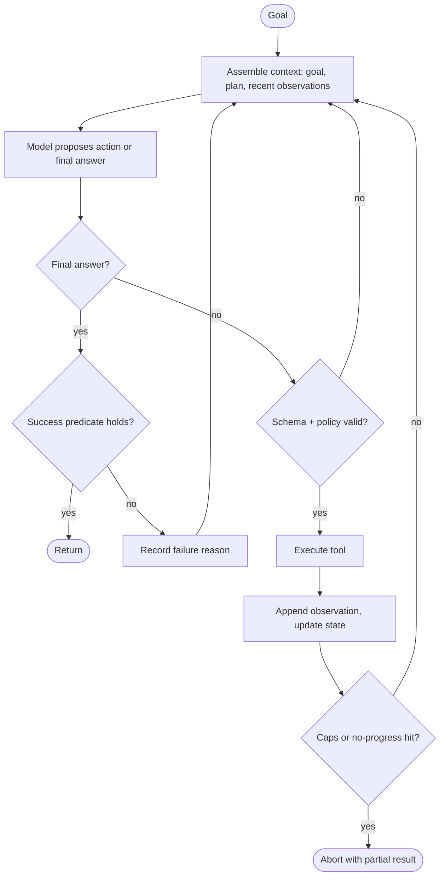

# Agent Core Loop

## Purpose
Every agent reduces to a loop: build context from state, ask the model for the next action, execute it, record the observation, decide whether to stop. Reliability comes from the parts around the model call: how context is assembled, how actions are validated, how progress is measured, and when the loop terminates. This skill covers those mechanics and the trade-offs between ReAct, plan-and-solve, and reflection variants.

## Agent Protocol

### Trigger
"agent loop", "ReAct", "plan-and-solve", "re-planning", "self-reflection", "Reflexion", "agent stuck in a loop", "termination condition", "max iterations".

### Input Context
- Current loop code or framework config.
- Typical task length and failure transcripts (where it loops, stalls, or stops early).
- Tool list with side-effect classification.

### Output Artifact
Loop specification or patch: state object, step function, termination rules, reflection policy.

### Response Format
```
Variant: {react|plan-and-solve|plan-execute-replan|reflexion}
State: {fields}
Step: assemble_context -> decide -> validate -> execute -> observe -> update
Stop when: {success test} OR steps>={n} OR no_progress>={k} OR budget>={usd}
Reflection: {trigger, input signal, where lessons are stored}
```

### Completion Criteria
- [ ] Success is a checkable predicate, not "model says done".
- [ ] Explicit caps and a no-progress detector.
- [ ] Actions validated before execution.
- [ ] Reflection uses an external signal (test result, error, evaluator), not introspection alone.

## The Loop as a State Machine



## Variants

| Variant | How it works | Strength | Weakness |
|---|---|---|---|
| ReAct | Decide one action at a time from latest observation | Adapts to surprises | Drifts on long tasks; myopic |
| Plan-and-solve | Write full plan, then execute in order | Coherent on long tasks | Brittle when a step fails |
| Plan-execute-replan | Plan, execute one step, revise remaining plan | Coherent and adaptive | Extra LLM call per step |
| Reflexion | After a failed attempt, write a verbal lesson; retry with lessons in context | Learns across attempts | Needs a reliable failure signal |
| LLMCompiler-style | Plan a DAG of tool calls, run independent ones in parallel | Lower latency | Planning errors propagate |

Rule of thumb: start with ReAct for short tasks (< ~10 steps); add an explicit plan object once tasks get longer or drift appears; add reflection only when you have an automatic success test.

## Reference Implementation (framework-agnostic)

```python
from __future__ import annotations

import hashlib
import json
from dataclasses import dataclass, field
from typing import Any, Callable, Protocol


class Policy(Protocol):
    def decide(self, context: str) -> dict[str, Any]: ...  # {"type": "tool"|"final", ...}


@dataclass
class LoopState:
    goal: str
    plan: list[str] = field(default_factory=list)
    observations: list[str] = field(default_factory=list)
    lessons: list[str] = field(default_factory=list)
    seen_calls: dict[str, int] = field(default_factory=dict)
    steps: int = 0
    steps_without_progress: int = 0


class LoopAborted(RuntimeError):
    pass


def run_loop(
    state: LoopState,
    policy: Policy,
    tools: dict[str, Callable[..., str]],
    is_success: Callable[[str, LoopState], bool],
    max_steps: int = 15,
    max_no_progress: int = 3,
) -> str:
    while state.steps < max_steps:
        state.steps += 1
        context = "\n".join([
            f"GOAL: {state.goal}",
            "PLAN:\n" + "\n".join(state.plan),
            "LESSONS:\n" + "\n".join(state.lessons[-5:]),
            "RECENT OBSERVATIONS:\n" + "\n".join(state.observations[-6:]),
        ])
        action = policy.decide(context)

        if action["type"] == "final":
            if is_success(action["answer"], state):
                return action["answer"]
            state.lessons.append(f"Answer rejected by success check at step {state.steps}")
            continue

        name, args = action["tool"], action.get("args", {})
        if name not in tools:
            state.observations.append(f"ERROR: unknown tool '{name}'. Valid: {sorted(tools)}")
            continue

        key = hashlib.sha256(json.dumps([name, args], sort_keys=True).encode()).hexdigest()
        state.seen_calls[key] = state.seen_calls.get(key, 0) + 1
        if state.seen_calls[key] > 2:
            state.observations.append(f"NOTE: {name} called 3x with identical args; change approach.")
            state.steps_without_progress += 1
        else:
            try:
                result = tools[name](**args)
                state.observations.append(f"{name} -> {result[:2000]}")
                state.steps_without_progress = 0
            except Exception as exc:
                state.observations.append(f"{name} FAILED: {type(exc).__name__}: {exc}")
                state.steps_without_progress += 1

        if state.steps_without_progress >= max_no_progress:
            raise LoopAborted(f"no progress for {max_no_progress} steps; last: {state.observations[-1]}")
    raise LoopAborted(f"step cap {max_steps} reached for goal: {state.goal[:80]}")
```

## Termination Rules
1. **Success predicate**: tests pass, schema validates, the user-visible artifact exists. Never trust "I am done" alone.
2. **Hard caps**: steps, tokens, wall clock, money.
3. **No-progress detector**: repeated identical calls, repeated identical errors, or no state change for k steps.
4. **Escalation**: on abort, return partial results plus the reason, and route to a human when the task matters.

## Reflection Done Right
- Trigger on a concrete failure (test failure, exception, evaluator rejection).
- Feed the failure evidence, not just "try again".
- Store lessons as short imperative notes ("run migrations before tests"), cap how many are kept, and drop stale ones.
- Measure: a reflection step that does not raise the success rate on your eval set is pure cost.

## Anti-Patterns
- Asking the model whether it succeeded instead of checking.
- Unlimited history: early constraints scroll out or get diluted; keep goal and plan pinned.
- Parsing free-text "Action:" lines when native tool calling is available.
- Retrying the same failing call with identical arguments.
- Planning once and never revising.

## Checklist
- [ ] State object with goal, plan, observations, lessons, counters.
- [ ] Context assembly pins goal/plan; observations truncated and windowed.
- [ ] Unknown tools and invalid args returned as observations, not crashes.
- [ ] Duplicate-call and no-progress detection.
- [ ] Success predicate implemented in code.
- [ ] Abort path returns partial work and reason.

## References
- Yao et al., "ReAct" (ICLR 2023); Shinn et al., "Reflexion" (NeurIPS 2023); Kim et al., "An LLM Compiler for Parallel Function Calling" (ICML 2024).
- Parent: `../SKILL.md`; planning detail: `../references/planning-strategies.md`.
