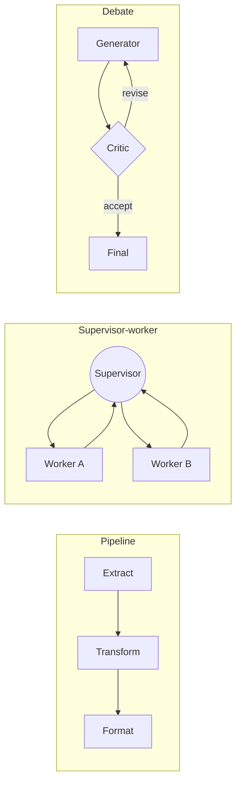

# Multi-Agent Topology

## Purpose
A topology is the graph of who talks to whom, who decides, and what data crosses each edge. Adding agents adds latency, cost, and failure points, so the first question is whether more than one agent is needed at all. When it is, pick the simplest topology that gives each agent a narrow role, a small tool set, and a typed contract with its neighbours.

## Agent Protocol

### Trigger
"supervisor", "worker agents", "agent hierarchy", "agent pipeline", "handoff", "debate", "critic agent", "should this be multi-agent".

### Input Context
- Task decomposition: subtasks, dependencies, and which need different tools or permissions.
- Tool count and context size if done by one agent.
- Latency/cost budget; need for parallelism.
- Where human approval is required.

### Output Artifact
Topology diagram (Mermaid), role table, edge contracts (typed messages), termination and failure rules.

### Response Format
```
Topology: {single|pipeline|supervisor-worker|hierarchical|handoff|debate}
Why multi-agent: {tool split | context isolation | parallelism | separation of duties}
Roles: {agent: responsibility, tools, can_write?}
Edges: {from -> to: message schema}
Termination: {condition}; max rounds={n}
Failure: {retry | reroute | escalate}
```

### Completion Criteria
- [ ] Single-agent baseline considered and rejected with a reason.
- [ ] Each agent has a small, cohesive toolset (split past ~10-15 tools or on eval evidence) and least privilege (reviewers read-only).
- [ ] Every edge has a typed schema.
- [ ] Round/turn limits on every cycle.
- [ ] HITL breakpoint before production-mutating nodes.

## When Multiple Agents Pay Off
| Reason | Example |
|---|---|
| Tool/permission separation | Coder can write files; reviewer can only read |
| Context isolation | Research sub-agents each read many pages, return short summaries |
| Parallelism | Independent subtasks fan out and run concurrently |
| Separation of duties | Generator and independent verifier |

Poor reasons: "it mirrors a human org chart", "more agents = smarter". Multi-agent systems typically use several times more tokens than a single agent; justify the spend with measured quality gains.

## Topologies



| Topology | Control | Best for | Main risk | Mitigation |
|---|---|---|---|---|
| Pipeline | Fixed order | Known stages | Error propagation | Validate between stages |
| Supervisor-worker | Central router | Dynamic delegation | Supervisor bottleneck, lossy summaries | Typed results, supervisor never executes |
| Hierarchical | Supervisors of supervisors | Very large tasks | Latency, telephone effect | Limit depth to 2 |
| Handoff (peer transfer) | Current agent passes control | Conversational triage | Ping-pong loops | Handoff count cap |
| Debate / critic | Generator + critic(s) | Quality-critical outputs | Sycophantic agreement, cost | Ground critic in tests/evidence; round cap |
| Parallel + aggregator | Fan-out/fan-in | Independent subtasks, voting | Inconsistent outputs | Deterministic merge rules |

## Edge Contracts
Pass structured state, not free-form chat logs:

```python
from __future__ import annotations

from typing import Literal

from pydantic import BaseModel, Field


class WorkOrder(BaseModel):
    task_id: str
    objective: str
    inputs: dict[str, str]
    constraints: list[str] = Field(default_factory=list)
    deadline_s: int = 300


class WorkResult(BaseModel):
    task_id: str
    status: Literal["done", "failed", "needs_human"]
    summary: str = Field(max_length=2000)
    artifacts: list[str] = Field(default_factory=list)   # file paths / ids, not blobs
    evidence: list[str] = Field(default_factory=list)    # test output, sources
```

Validate every message against its schema at the boundary; a malformed result is a failed task, not something to "interpret".

## Supervisor Rules
1. The supervisor routes, aggregates, and decides termination; it does not do the domain work.
2. Workers get the minimum context for their task (objective, inputs, constraints), not the whole conversation.
3. Results return as summaries plus artifact references, keeping the supervisor's context small.
4. A global budget (steps, tokens, time) is owned by the supervisor and enforced on every dispatch.

## Debate That Works
- Critics must cite evidence (failing test, source mismatch), otherwise their critique is ignored.
- Use different instructions or models for generator and critic to reduce correlated errors.
- Fixed number of rounds (2-3 typical); stop early on accept.
- Aggregate by rules (all tests pass, majority vote on discrete answers), not by asking another model "which is better" without criteria.

## Anti-Patterns
- Agents chatting in an unbounded group chat until someone says "TERMINATE".
- Passing full transcripts between agents (context bloat, prompt injection propagation).
- Every agent having every tool.
- Deep hierarchies (3+ levels) for tasks a pipeline could do.
- No owner for the global budget.

## Checklist
- [ ] Single-agent baseline measured.
- [ ] Topology chosen from table with stated risk mitigations.
- [ ] Roles, tools, and write permissions per agent.
- [ ] Pydantic/TypedDict schemas on every edge.
- [ ] Round caps, global budget, HITL before destructive nodes.
- [ ] Per-agent traces linked by one trace id.

## References
- Du et al., "Improving Factuality and Reasoning in Language Models through Multiagent Debate" (2023).
- Anthropic, "How we built our multi-agent research system" (2025) — orchestrator-worker with context isolation.
- Sibling: `../../multi-agent-systems/SKILL.md` for runtime/framework selection.
