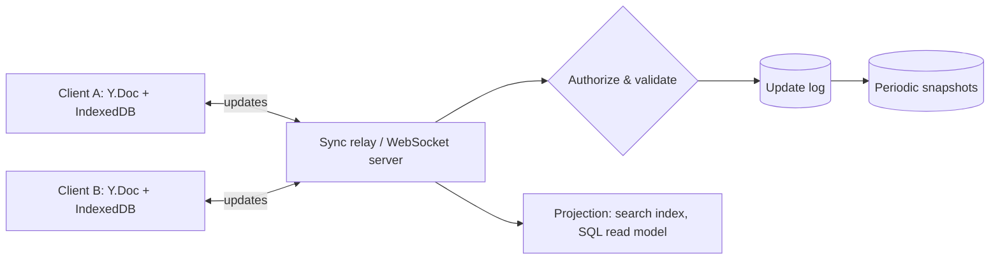

# Conflict-free Replicated Data Types (CRDTs)

## Purpose
CRDTs let replicas accept writes independently (offline, peer-to-peer, multi-region) and still converge to the same state once they have seen the same updates, with no central lock or transform server. They trade some storage and semantic control for availability and simple sync. Use proven libraries; design the document model, sync transport, persistence, and access control around them.

## Agent Protocol

### Trigger
"CRDT", "collaborative editor", "multiplayer editing", "Yjs", "Automerge", "Loro", "local-first", "offline merge", "OT vs CRDT", "conflict resolution without server".

### Input Context
- Data shape (text, rich text, lists, maps, counters, trees/canvas).
- Concurrency: number of simultaneous editors, offline duration.
- Topology: client-server relay, peer-to-peer, multi-region servers.
- Auth model and audit/history requirements.

### Output Artifact
CRDT design: per-field type, library choice, sync/persistence architecture, compaction and auth plan.

### Response Format
```
Document model: {field: CRDT type}
Library: {Yjs|Automerge|Loro}  Transport: {WebSocket relay|WebRTC|HTTP sync}
Persistence: {updates log + snapshots}  Compaction: {policy}
Auth: {room-level|server-validated updates}
Semantics caveats: {e.g. LWW on title, interleaving}
```

### Completion Criteria
- [ ] Each field's merge semantics stated (what happens on concurrent edits).
- [ ] Server validates who may write which document.
- [ ] Persistence keeps update log + periodic snapshots; growth bounded.
- [ ] Convergence tested with randomized concurrent operations.

## Two Families
| Family | Replicas exchange | Requirement on merge/delivery |
|---|---|---|
| State-based (CvRDT) | Whole state (or deltas) | Merge is commutative, associative, idempotent (a join-semilattice); any delivery order, duplicates OK |
| Operation-based (CmRDT) | Operations | Concurrent ops commute; delivery exactly-once and causally ordered (usually provided by the library's sync protocol) |

Delta-state CRDTs ship only the changed part of the state; Yjs and Automerge use compact update encodings with state vectors/heads so peers send only what the other side lacks.

## Common Types
| Type | Merge rule | Caveat |
|---|---|---|
| G-Counter | Per-replica counts, merge = elementwise max, value = sum | Increment only |
| PN-Counter | Two G-Counters (inc, dec) | Can go negative |
| LWW-Register | Highest (timestamp, replica id) wins | Needs good clocks (hybrid logical clocks); silently drops one write |
| MV-Register | Keep all concurrent values | App must resolve |
| OR-Set (add-wins) | Adds tagged uniquely; remove deletes observed tags | Metadata grows |
| Sequence (RGA, YATA, Fugue) | Elements get unique ids ordered relative to neighbours | Tombstones; concurrent inserts must not interleave badly |
| JSON/map CRDT | Nested maps/lists of the above | Concurrent move/reparent is hard (tree CRDTs) |

```typescript
// G-Counter: the canonical state-based CRDT
type GCounter = Record<string, number>;

export const increment = (c: GCounter, replica: string, by = 1): GCounter => {
  if (by < 0) throw new RangeError(`G-Counter cannot decrement (replica=${replica}, by=${by})`);
  return { ...c, [replica]: (c[replica] ?? 0) + by };
};

export const merge = (a: GCounter, b: GCounter): GCounter => {
  const out: GCounter = { ...a };
  for (const [r, n] of Object.entries(b)) out[r] = Math.max(out[r] ?? 0, n);
  return out;
};

export const value = (c: GCounter): number => Object.values(c).reduce((s, n) => s + n, 0);
```

## CRDT vs Operational Transformation
| | OT | CRDT |
|---|---|---|
| Coordination | Central server orders and transforms ops | None required |
| Offline / P2P | Poor | Native |
| Metadata | Small | Ids/tombstones per element (modern libs compress heavily) |
| Intent control | Server can enforce | Merge rule is fixed by type |
| Examples | Google Docs (historically), ShareDB | Yjs, Automerge, Loro |

If you already have a single authoritative server and no offline requirement, server-ordered ops (OT or simple last-write with versioning) can be simpler.

## Library Usage

Yjs (shared types + y-websocket relay):
```typescript
import * as Y from "yjs";
import { WebsocketProvider } from "y-websocket";
import { IndexeddbPersistence } from "y-indexeddb";

const doc = new Y.Doc();
new IndexeddbPersistence("doc-42", doc);                       // offline cache
const provider = new WebsocketProvider("wss://sync.example.com", "doc-42", doc);

const text = doc.getText("body");
const meta = doc.getMap("meta");
doc.transact(() => {                                            // one update event
  text.insert(0, "Hello");
  meta.set("title", "Draft");                                   // map keys: last-writer-wins
});
provider.awareness.setLocalStateField("user", { name: "Ana" }); // presence, not persisted

// Server-side or tests: exchange binary updates
const update = Y.encodeStateAsUpdate(doc);
const replica = new Y.Doc();
Y.applyUpdate(replica, update);
```

Automerge (JSON-like documents, full history):
```typescript
import * as A from "@automerge/automerge";

let a = A.from({ tasks: [] as { title: string; done: boolean }[], votes: new A.Counter(0) });
let b = A.clone(a);
a = A.change(a, d => { d.tasks.push({ title: "Write spec", done: false }); });
b = A.change(b, d => { d.votes.increment(1); });
const merged = A.merge(a, b);   // contains both changes
```
For networking and storage, Automerge Repo (`@automerge/automerge-repo`) provides sync adapters.

## Architecture

- The server is a relay plus persistence, but it is still the place for **authorization**: check the user may write the room before accepting updates; validate update size and rate.
- Persist incremental updates; periodically merge them into a snapshot (`Y.encodeStateAsUpdate`) and truncate the log.
- Project CRDT state into ordinary tables for search, reporting, and server-side business rules.

## Pitfalls
- **Valid merge ≠ valid business state**: two users each book the last seat; both merges are "correct". Invariants needing exclusivity (uniqueness, balances) need a server-side authority or reservation.
- **Tombstone growth**: deleted text still has metadata; enable garbage collection (Yjs `gc: true`, default) unless you need full history, and snapshot.
- **Clock skew in LWW**: use hybrid logical clocks, never raw wall clocks alone.
- **Schema evolution**: field renames are new fields; write migrations that copy data inside a change, version the document schema.
- **Undo**: must be per-user (`Y.UndoManager` with tracked origins), not global.
- **Large docs**: split into sub-documents (one per page/board) to bound load time.

## Checklist
- [ ] Field-by-field CRDT type and concurrent-edit semantics documented.
- [ ] Library chosen; no hand-rolled sequence CRDT.
- [ ] Relay authorizes per document; rate and size limits.
- [ ] Update log + snapshot compaction; GC policy.
- [ ] Business invariants needing exclusivity handled server-side.
- [ ] Property-based tests: random concurrent ops on N replicas converge.
- [ ] Presence/awareness kept out of persisted state.

## References
- Shapiro et al., "Conflict-free Replicated Data Types" (SSS 2011).
- Kleppmann et al., "Local-first software" (Onward! 2019).
- Nicolaescu et al., YATA (GROUP 2016); Weidner & Kleppmann, "The Art of the Fugue" (2023).
- Yjs docs (shared types, providers, awareness); Automerge docs.
