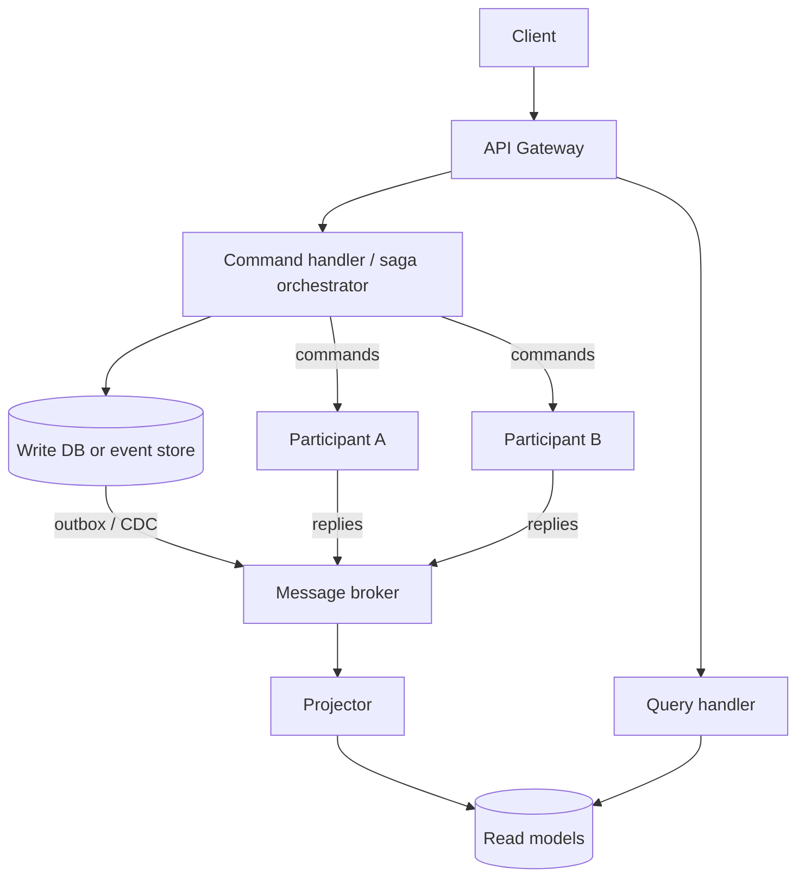

# Microservice Data-Consistency Patterns

## Purpose
With a database per service, one business operation spans several local transactions. This skill picks the pattern that keeps such operations consistent (sagas with compensation), separates read and write models when needed (CQRS), and shows how event sourcing and the outbox fit in.

## Agent Protocol

### Trigger
Exact user phrases: "saga pattern", "distributed transaction", "compensating transaction", "choreography vs orchestration", "CQRS with event sourcing", "cross-service consistency", "two-phase commit microservices".

### Input Context
- Business flow and participating services with their data stores.
- Which steps are reversible, and which have external side effects (payments, emails).
- Existing messaging infrastructure and workflow engines (Temporal, Camunda, AWS Step Functions).

### Output Artifact
Saga step table with compensations, chosen coordination style, and the event/command contracts. No files unless requested.

### Response Format
```
Saga: {name}   Style: {orchestration | choreography}
| # | Service | Action | Compensation | Retryable |
Pivot step: {step after which saga only moves forward}
Isolation countermeasure: {semantic lock | commutative update | reread}
Read model: {CQRS projection or none}
```

## 1. Saga: Distributed Transactions Without 2PC
Two-phase commit (XA) needs every participant to support it and holds locks while a coordinator decides; most brokers, NoSQL stores and SaaS APIs cannot participate, and a coordinator failure blocks participants. Sagas replace one global transaction with a sequence of local transactions, each publishing an event or replying to a command. On failure, already-completed steps are undone by **compensating transactions** (semantic undo such as "refund", not a rollback).

Step types:
- **Compensatable**: can be undone (reserve inventory -> release).
- **Pivot**: the go/no-go point (charge card). After it, the saga must complete.
- **Retryable**: steps after the pivot that must eventually succeed (send confirmation) and are retried until they do.

Order steps so that hard-to-undo actions come as late as possible.

### Choreography vs Orchestration

| | Choreography | Orchestration |
|---|---|---|
| Control | Each service reacts to others' events | Central orchestrator sends commands, tracks state |
| Coupling | Services know event types of others | Services know only their own commands |
| Visibility | Flow is implicit; hard to trace | Saga state is explicit and queryable |
| Good for | 2-4 steps, simple linear flows | Many steps, branching, timeouts, human tasks |
| Risk | Cyclic dependencies, "event spaghetti" | Orchestrator becomes a god service if it holds business logic |

Durable workflow engines (Temporal, Camunda 8, AWS Step Functions, Azure Durable Functions) implement orchestration with persisted state, timers and retries, so you do not hand-build a state machine.

### Orchestrated Saga Example (TypeScript, persisted state machine)

```ts
type Step = 'RESERVE_STOCK' | 'CHARGE' | 'SHIP' | 'DONE' | 'COMPENSATING' | 'FAILED';

interface OrderSaga {
  sagaId: string;
  orderId: string;
  step: Step;
  completed: Array<'RESERVE_STOCK' | 'CHARGE'>;
}

interface Deps {
  save(s: OrderSaga): Promise<void>;                       // persist before each command
  send(cmd: string, payload: object, key: string): Promise<void>; // via outbox
}

export async function onReply(saga: OrderSaga, reply: { ok: boolean }, deps: Deps) {
  if (!reply.ok) return compensate(saga, deps);
  switch (saga.step) {
    case 'RESERVE_STOCK':
      saga.completed.push('RESERVE_STOCK');
      saga.step = 'CHARGE';
      await deps.save(saga);
      return deps.send('ChargePayment', { orderId: saga.orderId }, `${saga.sagaId}:charge`);
    case 'CHARGE': // pivot: from here we only move forward
      saga.completed.push('CHARGE');
      saga.step = 'SHIP';
      await deps.save(saga);
      return deps.send('ScheduleShipment', { orderId: saga.orderId }, `${saga.sagaId}:ship`);
    case 'SHIP':
      saga.step = 'DONE';
      return deps.save(saga);
    default:
      throw new Error(`Unexpected reply for saga ${saga.sagaId} in step ${saga.step}`);
  }
}

async function compensate(saga: OrderSaga, deps: Deps) {
  saga.step = 'COMPENSATING';
  await deps.save(saga);
  for (const done of [...saga.completed].reverse()) {
    if (done === 'CHARGE') await deps.send('RefundPayment', { orderId: saga.orderId }, `${saga.sagaId}:refund`);
    if (done === 'RESERVE_STOCK') await deps.send('ReleaseStock', { orderId: saga.orderId }, `${saga.sagaId}:release`);
  }
  saga.step = 'FAILED';
  await deps.save(saga);
}
```

The third argument is an idempotency key: participants must deduplicate, because commands and replies are delivered at least once.

### Lack of Isolation
Sagas are ACD without I: other transactions see intermediate states. Countermeasures:
- **Semantic lock**: mark the record `PENDING` until the saga ends; other operations check the flag.
- **Commutative updates**: design operations so order does not matter (credit/debit deltas).
- **Reread value**: verify the record is unchanged before overwriting.
- **Version file / pessimistic view**: reorder steps to reduce exposure of risky intermediate states.

## 2. CQRS
Separate the write model (enforces invariants, normalized) from one or more read models (denormalized for specific queries). Read models are updated from events, so they are eventually consistent.

Use when read and write shapes differ heavily, read volume dwarfs writes, or queries span several services' data. Avoid for plain CRUD: it doubles the moving parts. Handle read-your-own-writes by returning the new state from the command, or by waiting for the projection to reach the command's version.

## 3. Event Sourcing
Persist the sequence of domain events as the source of truth; current state is a left fold over the events. Benefits: complete history, temporal queries, natural event publication. Costs: event schema versioning (upcasters), snapshotting for long streams, and GDPR erasure needs crypto-shredding or stream rewriting, so "never deleted" is a design choice, not a free property.

Event sourcing does not require CQRS in principle, but in practice querying requires projections, so the two are almost always combined.

## 4. How They Combine



Publishing must be atomic with the state change: use the transactional outbox or CDC, never "commit then publish" in application code.

## Decision Table

| Need | Pattern |
|---|---|
| Multi-service business transaction | Saga (orchestrated if >3 steps) |
| Atomic "save + publish" | Transactional outbox / CDC |
| Read-heavy cross-service queries | CQRS projection or API composition |
| Full audit history / temporal queries | Event sourcing |
| Strong consistency across two aggregates | Reconsider boundaries: maybe they belong in one service |

## Anti-Patterns
- Sagas without idempotent participants: redelivery double-charges.
- Compensations that can fail permanently with no alert or manual-repair queue.
- Using event sourcing for every service "for consistency".
- Synchronous HTTP chains (A calls B calls C) pretending to be a transaction.

## Checklist
- [ ] Each saga step lists action, compensation, and retry policy; pivot identified.
- [ ] Saga state persisted; timeouts defined for each step.
- [ ] All participants idempotent; messages published via outbox.
- [ ] Isolation countermeasure chosen for each exposed intermediate state.
- [ ] Read models have lag metrics and a rebuild procedure.

## References
- Related skills: `skills/backend/universal/microservices/SKILL.md`, `skills/backend/universal/cqrs-patterns/SKILL.md`, `skills/backend/universal/event-sourcing/SKILL.md`, `skills/backend/universal/transactional-outbox/SKILL.md`.
