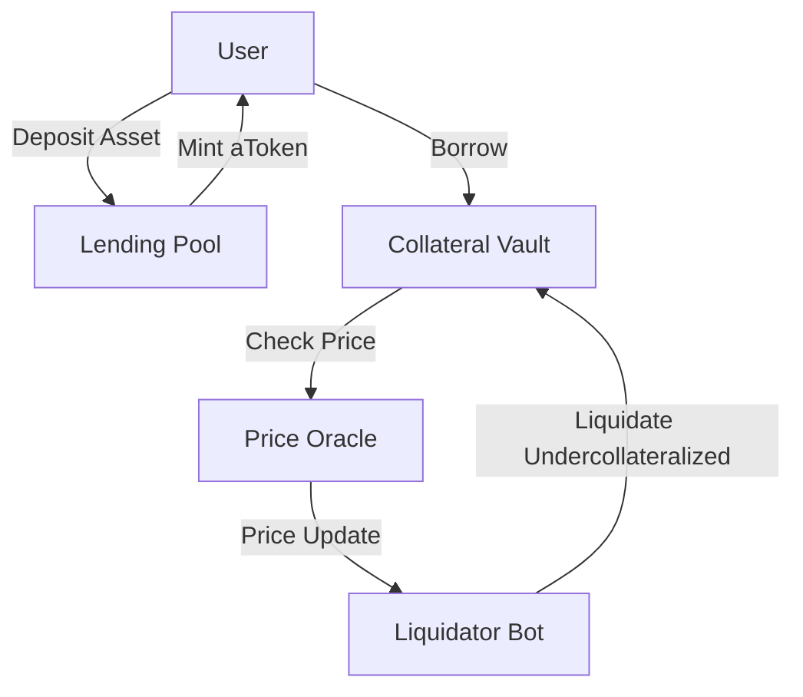

# DeFi Protocols

## Purpose
Explain the core on-chain primitives of DeFi: the constant-product AMM invariant and swap pricing (with fees), and over-collateralized lending with health-factor-driven liquidation. Provides correct reference formulas and minimal Solidity patterns for building or reviewing these protocols.

## Agent Protocol

### Trigger
User phrases: "AMM math", "x*y=k", "Uniswap swap formula", "lending pool", "health factor", "liquidation design".

### Input Context
- Protocol type (DEX/AMM vs lending) and token decimals.
- Fee tier and oracle/price source.

### Output Artifact
Formula/architecture explanation with minimal illustrative Solidity. No production deployment.

### Response Format
```
Primitive: {AMM | lending}
Formula: {invariant / health factor}
Risk: {IL | liquidation | oracle}
```

## AMM Math (Constant Product)
The fundamental formula for DEXes like Uniswap V2 is $x \times y = k$. With a 0.30% swap fee, the output for a given input is derived by keeping the product of reserves at least constant after the fee-adjusted input is added (the `997/1000` factors below encode the 0.30% fee).

```solidity
contract SimpleAMM {
    uint public reserve0;
    uint public reserve1;

    function swap(uint amountIn, bool isToken0) external returns (uint amountOut) {
        require(amountIn > 0, "Invalid amount");
        (uint reserveIn, uint reserveOut) = isToken0 ? (reserve0, reserve1) : (reserve1, reserve0);
        
        // amountOut = (amountIn * 997 * reserveOut) / (reserveIn * 1000 + amountIn * 997)
        uint amountInWithFee = amountIn * 997;
        amountOut = (amountInWithFee * reserveOut) / (reserveIn * 1000 + amountInWithFee);
        
        // Update reserves...
    }
}
```

## Lending Pool Architecture
Over-collateralized lending requires robust liquidation mechanisms. The Health Factor is `(collateral_value * liquidation_threshold) / total_debt_value`; when it drops below 1, the position is eligible for liquidation and a liquidator repays debt in exchange for discounted collateral (the liquidation bonus).

**Anti-patterns:** using a single spot price (manipulable via flash loans) as the liquidation oracle; ignoring `liquidation_threshold` vs `loan_to_value` (LTV) distinction; and allowing self-liquidation griefing. Use a robust oracle (Chainlink or a TWAP) and enforce a close factor cap per liquidation.

## Protocol Interactions

