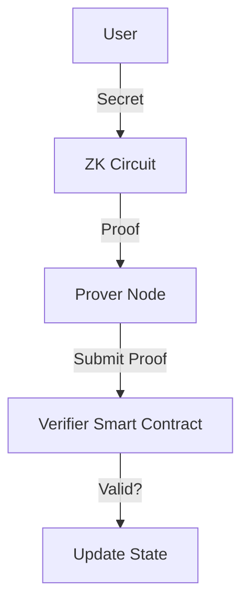

# Zero-Knowledge Proofs

## Purpose
Explain how to build and prove zero-knowledge statements: authoring constrained arithmetic circuits in Circom, selecting a proving system (Groth16 vs PLONK and their setup trade-offs), and managing the trusted setup. Emphasizes constraint completeness so circuits are sound, not just satisfiable.

## Agent Protocol

### Trigger
User phrases: "ZK circuit", "Circom template", "zk-SNARK", "Groth16 vs PLONK", "trusted setup / ptau", "verifier contract".

### Input Context
- Circuit language/toolchain (Circom + snarkjs, Halo2, Noir).
- Proving-system constraints (setup, proof size, verifier gas).

### Output Artifact
Circuit design and proving-system recommendation with setup guidance.

### Response Format
```
Statement: {what is proven}
System: {Groth16 | PLONK | STARK}
Setup: {per-circuit | universal | transparent}
```

## ZK Circuits (Circom)
Create arithmetic circuits to prove knowledge of a pre-image without revealing it. Every signal must be *constrained* (`<==` or `===`), not merely assigned (`<--`): an unconstrained signal lets a malicious prover forge satisfying witnesses.

```circom
pragma circom 2.0.0;
include "node_modules/circomlib/circuits/poseidon.circom";

template SecretHasher() {
    signal input secret;
    signal output hash;

    component poseidon = Poseidon(1);
    poseidon.inputs[0] <== secret;
    hash <== poseidon.out;
}

component main = SecretHasher();
```

## zk-SNARKs
Use Groth16 or PLONK for succinct non-interactive arguments of knowledge.
- **Groth16**: smallest proofs and cheapest on-chain verification, but requires a *circuit-specific* trusted setup (a per-circuit Phase 2 on top of the universal Powers of Tau / `.ptau`). Changing the circuit requires a new Phase 2.
- **PLONK**: slightly larger proofs, but uses a *universal, updatable* setup (one Powers of Tau ceremony reused across circuits) — preferred when the circuit changes often.
- A trusted setup is only as safe as its participants: if all contributors to a ceremony collude, they can forge proofs. Transparent systems (STARKs, Halo2 without a trusted setup) avoid this at the cost of larger proofs.

## Privacy Protocol Architecture

