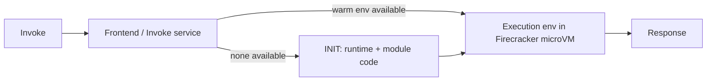

# AWS Lambda Internals and Function Design

## Purpose
Explain what actually happens when a Lambda function is invoked — Firecracker microVM isolation, the execution environment lifecycle, and the concurrency model — so that function code, timeouts, memory, and event-source settings are chosen from mechanics rather than folklore.

## Agent Protocol

### Trigger
"aws lambda internals", "firecracker", "lambda execution environment", "lambda concurrency", "event source mapping", "lambda function url", "lambda layers", "reserved concurrency", "lambda timeout".

### Input Context
- Runtime and package type (ZIP managed runtime, container image, custom runtime).
- Invocation source (API Gateway, Function URL, SQS, Kinesis/DynamoDB Streams, EventBridge, S3).
- Traffic shape (steady, bursty), latency SLO, downstream limits (DB connections, third-party rate limits).

### Output Artifact
Function configuration (IaC snippet) plus handler structure. No file unless requested.

### Response Format
```
Invocation model: {sync|async|poll-based (ESM)}
Memory / timeout: {MB} / {s}  (why)
Concurrency: {unreserved|reserved=N|provisioned=N}
Retries / failure destination: {...}
Handler notes: {init vs handler work}
```

### Completion Criteria
- [ ] Invocation model identified and retry semantics stated.
- [ ] Timeout set below the caller's timeout (API Gateway integration timeout defaults to 29 s).
- [ ] Concurrency protects downstream dependencies.
- [ ] Failure path defined (DLQ, on-failure destination, or partial batch response).

## How an Invocation Runs

1. **Firecracker microVM.** Lambda runs each execution environment inside a Firecracker microVM on KVM. Firecracker exposes a minimal device model (virtio-net, virtio-block, serial console, keyboard for reset) and is documented to boot in about 125 ms with under 5 MiB memory overhead per microVM. Isolation boundary = the VM, not a container.
2. **Execution environment lifecycle** (Lambda Runtime API phases):
   - `INIT` — download code/layers, start runtime, run extensions' init, run your module-level code. Limited to 10 s for on-demand functions; if it exceeds, init is retried inside the first invoke.
   - `INVOKE` — handler runs; one environment processes **one request at a time**.
   - `SHUTDOWN` — environment reclaimed after idle; the phase lasts 0 ms with no extensions, 500 ms with internal extensions, 2,000 ms with external extensions.
3. **Reuse.** A warm environment is reused for later invocations; globals, `/tmp` (512 MB default, configurable up to 10,240 MB), and open sockets survive. Never rely on reuse for correctness.



## Concurrency Model

- Concurrency = in-flight requests ≈ requests/second × average duration (s).
- Account default: 1,000 concurrent executions per Region (soft quota).
- Scaling rate: each function can add up to 1,000 concurrent executions every 10 seconds (current behaviour since late 2023; older "burst concurrency per Region" tables are obsolete).
- **Reserved concurrency** caps a function and guarantees that capacity; setting it to 0 throttles the function (useful kill switch).
- **Provisioned concurrency** keeps N initialized environments; billed while configured.

| Source | Invocation | Retries on error | Failure handling |
|---|---|---|---|
| API Gateway, Function URL, SDK `RequestResponse` | Sync | None (caller retries) | Return error to caller |
| S3, SNS, EventBridge, SDK `Event` | Async (internal queue) | 2 retries by default (0–2), max event age up to 6 h | On-failure destination or DLQ |
| SQS | Poll (ESM) | Until visibility timeout/maxReceiveCount | Queue redrive DLQ, `ReportBatchItemFailures` |
| Kinesis / DynamoDB Streams | Poll (ESM) | Until record expires unless limited | `MaximumRetryAttempts`, `BisectBatchOnFunctionError`, on-failure destination |

## Function Configuration (Terraform)

```hcl
resource "aws_lambda_function" "orders" {
  function_name = "orders-api"
  role          = aws_iam_role.orders.arn
  runtime       = "python3.12"
  handler       = "app.handler"
  filename      = "build/orders.zip"
  source_code_hash = filebase64sha256("build/orders.zip")
  architectures = ["arm64"]          # Graviton: usually cheaper per GB-s
  memory_size   = 1024               # CPU scales with memory (1 vCPU ≈ 1,769 MB)
  timeout       = 25                 # below API Gateway's 29 s integration timeout
  reserved_concurrent_executions = 200 # protects the database

  environment {
    variables = { TABLE_NAME = aws_dynamodb_table.orders.name }
  }
  tracing_config { mode = "Active" }
}

resource "aws_lambda_event_source_mapping" "queue" {
  event_source_arn = aws_sqs_queue.jobs.arn
  function_name    = aws_lambda_function.worker.arn
  batch_size       = 10
  function_response_types = ["ReportBatchItemFailures"]
  scaling_config { maximum_concurrency = 50 } # SQS-only cap, 2..1000
}
```

## Handler Structure

```python
import json, os
import boto3

# INIT phase: runs once per execution environment, reused while warm
dynamodb = boto3.resource("dynamodb")
table = dynamodb.Table(os.environ["TABLE_NAME"])

def handler(event, context):
    failures = []
    for record in event.get("Records", []):
        try:
            body = json.loads(record["body"])
            table.put_item(
                Item={"pk": body["order_id"], "status": "RECEIVED"},
                ConditionExpression="attribute_not_exists(pk)",  # idempotent
            )
        except dynamodb.meta.client.exceptions.ConditionalCheckFailedException:
            continue  # duplicate delivery: already processed
        except Exception:
            failures.append({"itemIdentifier": record["messageId"]})
    return {"batchItemFailures": failures}
```

## Decision Rules
- Need > 15 min, long-lived connections, or GPUs → not Lambda (ECS/Fargate, Batch, EKS).
- SQS visibility timeout ≥ 6 × function timeout (AWS guidance) to avoid duplicate processing during retries.
- Relational DB behind Lambda → RDS Proxy or a reserved-concurrency cap; otherwise connection storms.
- Payload limits: 6 MB sync request/response; 1 MB async event (raised from 256 KB in Oct 2025, bytes above 256 KB billed in 64 KB chunks). Use S3 pointers for anything larger.
- Prefer Function URLs for a single simple HTTPS endpoint; API Gateway when you need usage plans, request validation, or WAF on REST APIs.

## Anti-Patterns
| Anti-pattern | Why it hurts | Fix |
|---|---|---|
| Lambda calling Lambda synchronously | Double billing, cascading timeouts | Step Functions or async events |
| Recursive S3 trigger writing to same bucket/prefix | Infinite loop (Lambda recursion detection stops some loops, don't rely on it) | Separate output prefix/bucket |
| Unbounded concurrency to a fragile dependency | Throttles/outages downstream | Reserved concurrency or ESM `maximum_concurrency` |
| Secrets in plain environment variables | Visible to anyone with `GetFunctionConfiguration` | Secrets Manager / Parameter Store with caching extension |
| Non-idempotent handlers | At-least-once delivery creates duplicates | Conditional writes, idempotency keys (Powertools Idempotency) |

## Checklist
- [ ] arm64 evaluated; memory right-sized (AWS Lambda Power Tuning).
- [ ] Timeout < caller timeout; SQS visibility timeout sized from it.
- [ ] Idempotent handler; partial batch failure enabled for SQS/streams.
- [ ] Failure destination/DLQ with alarm.
- [ ] Least-privilege execution role; X-Ray or OpenTelemetry tracing on.

## References
- Related skills: `skills/cloud-native/serverless-cold-starts/SKILL.md`, `skills/devops/serverless/SKILL.md`.
