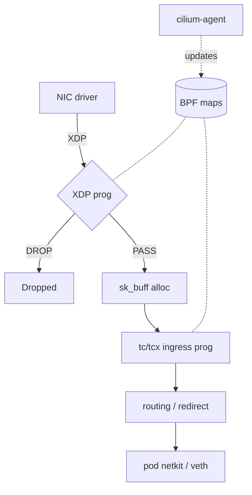

# eBPF Networking and the Cilium Datapath

## Purpose
eBPF lets verified programs run at kernel hook points, so networking (load balancing, policy, NAT, DDoS filtering) can happen without iptables chains or user-space proxies. Knowing which hook runs where explains Cilium's performance characteristics and its kernel requirements.

## Agent Protocol

### Trigger
"ebpf networking", "XDP", "tc ebpf", "cilium datapath", "kube-proxy replacement", "DSR", "netkit", "bpf maps", "xdp drop".

### Input Context
- Kernel version(s) on nodes, NIC driver (native XDP support), cloud vs bare metal.
- Goal: kube-proxy replacement, network policy, DDoS filtering, custom LB.

### Output Artifact
Explanation, hook choice, and/or libbpf program + loader steps. No file unless requested.

### Response Format
```
Hook: {XDP native|XDP generic|tc/tcx ingress|tc/tcx egress|cgroup/connect4|sockops}
Why: {position in stack, available context}
Min kernel: {version}
Program/map design: {...}
Verification: {bpftool commands}
```

### Completion Criteria
- [ ] Hook justified by where in the stack the decision must happen.
- [ ] Code passes the verifier: all packet accesses bounds-checked; GPL-compatible license when GPL helpers used.
- [ ] Minimum kernel version stated.

## Hook Points (ingress order)
| Hook | Runs | Context | Typical use |
|---|---|---|---|
| XDP (native, in driver) | Before `sk_buff` allocation | `struct xdp_md` (raw frame) | DDoS drop, L4 LB, early filtering |
| XDP generic | After `sk_buff` allocation (fallback) | same API, slower | Testing / NICs without native XDP |
| XDP offload | On SmartNIC hardware | limited | Few NICs support it |
| tc / tcx ingress & egress | In the traffic-control layer with `sk_buff` | `struct __sk_buff` | Policy, NAT, redirects between devices; tcx (kernel 6.6+) is the newer link-based attach API |
| cgroup socket hooks (`connect4/6`, `sendmsg4`, `recvmsg4`) | On socket syscalls | socket address | Socket-level LB: rewrite ClusterIP to backend at `connect()` |
| sockops / sk_msg | TCP events / socket messages | socket | Socket-to-socket redirect on the same host |

XDP actions: `XDP_DROP`, `XDP_PASS`, `XDP_TX` (bounce out same NIC), `XDP_REDIRECT` (other NIC, CPU via cpumap, or AF_XDP socket via xskmap), `XDP_ABORTED` (drop + tracepoint).

## How Cilium Uses Them
- **Endpoint datapath:** programs on each pod's host-side device (veth with tc/tcx, or **netkit** devices in Cilium 1.16+ on kernel ≥ 6.8, which run the BPF program inside the device to avoid extra traversal). Policy is enforced via identity lookups in BPF maps — security identities derived from pod labels, not IP-based iptables rules.
- **kube-proxy replacement:** `kubeProxyReplacement=true`; ClusterIP translation done at socket level (cgroup `connect` hooks) for in-cluster clients, and in tc/XDP for NodePort/LoadBalancer traffic. Service backends live in BPF maps updated by the agent.
- **XDP acceleration** for NodePort/LoadBalancer (`loadBalancer.acceleration=native`) on NICs with native XDP.
- **DSR** (`loadBalancer.mode=dsr` or hybrid): backend replies directly to the client, skipping the LB node on the return path; requires the encapsulation/IP option support in your network.
- **Maps**: connection tracking (`cilium_ct*`), NAT, service/backends, policy, endpoints. The agent (user space) watches the K8s API and updates maps; the datapath never calls back to user space per packet.



## Example: XDP Blocklist (libbpf, CO-RE)
```c
// xdp_blocklist.bpf.c — needs kernel with BTF (CONFIG_DEBUG_INFO_BTF), LPM trie (>= 4.11), XDP native driver support
#include "vmlinux.h"
#include <bpf/bpf_helpers.h>
#include <bpf/bpf_endian.h>

#define ETH_P_IP 0x0800

struct lpm_v4_key {
    __u32 prefixlen;
    __u32 addr;      /* network byte order */
};

struct {
    __uint(type, BPF_MAP_TYPE_LPM_TRIE);
    __uint(max_entries, 65536);
    __uint(map_flags, BPF_F_NO_PREALLOC);
    __type(key, struct lpm_v4_key);
    __type(value, __u8);
} blocklist SEC(".maps");

struct {
    __uint(type, BPF_MAP_TYPE_PERCPU_ARRAY);
    __uint(max_entries, 1);
    __type(key, __u32);
    __type(value, __u64);
} drops SEC(".maps");

SEC("xdp")
int xdp_blocklist(struct xdp_md *ctx)
{
    void *data = (void *)(long)ctx->data;
    void *data_end = (void *)(long)ctx->data_end;

    struct ethhdr *eth = data;
    if ((void *)(eth + 1) > data_end)
        return XDP_PASS;
    if (eth->h_proto != bpf_htons(ETH_P_IP))
        return XDP_PASS;

    struct iphdr *ip = (void *)(eth + 1);
    if ((void *)(ip + 1) > data_end)
        return XDP_PASS;

    struct lpm_v4_key key = { .prefixlen = 32, .addr = ip->saddr };
    if (bpf_map_lookup_elem(&blocklist, &key)) {
        __u32 zero = 0;
        __u64 *cnt = bpf_map_lookup_elem(&drops, &zero);
        if (cnt)
            (*cnt)++;               /* per-CPU map: no atomics needed */
        return XDP_DROP;
    }
    return XDP_PASS;
}

char LICENSE[] SEC("license") = "GPL";
```
Build and load:
```bash
bpftool btf dump file /sys/kernel/btf/vmlinux format c > vmlinux.h
clang -O2 -g -target bpf -c xdp_blocklist.bpf.c -o xdp_blocklist.bpf.o
ip link set dev eth0 xdpdrv obj xdp_blocklist.bpf.o sec xdp   # native mode; 'xdpgeneric' to fall back
bpftool prog show; bpftool map dump name drops
```
For production loaders use a `bpftool gen skeleton` skeleton (C), `cilium/ebpf` (Go), or `aya` (Rust) rather than `ip link`.

## Constraints
- Verifier: every pointer access bounds-checked against `data_end`; 512-byte stack; loops must provably terminate.
- XDP sees only ingress; egress filtering needs tc/tcx.
- Encapsulated traffic (VXLAN/Geneve) must be parsed through outer headers.
- Cloud VMs: native XDP support depends on the virtual NIC driver (e.g. ENA, gVNIC, virtio-net with multiqueue); check before relying on it.

## Anti-Patterns
- Using BCC Python for production datapaths (needs kernel headers + compiler on every node).
- Mixing kube-proxy and kube-proxy replacement without understanding which handles which service type.
- Hash map for CIDR matching (use LPM trie).
- Global counters in shared maps without atomics/per-CPU maps.

## Checklist
- [ ] Kernel versions inventoried against Cilium's system requirements.
- [ ] XDP mode (native vs generic) confirmed with `ip link show`.
- [ ] Maps sized; LRU maps for connection-like state.
- [ ] Observability via Hubble or `bpftool`/`pwru` for drops.

## References
- Related skills: `skills/devops/cilium-ebpf/SKILL.md`, `skills/cloud-native/ebpf-observability/SKILL.md`, `skills/low-level/ebpf-engineering/SKILL.md`.
