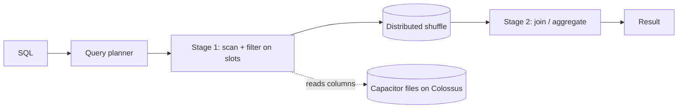

# GCP BigQuery Internals and Optimization

## Purpose
BigQuery cost and speed are determined by bytes read and slot time. Knowing how Dremel distributes work and how Capacitor stores columns explains why partitioning, clustering, and column selection matter more than anything else.

## Agent Protocol

### Trigger
"bigquery", "bigquery cost", "partitioning", "clustering", "dremel", "capacitor", "slots", "editions", "slow query", "bytes scanned".

### Input Context
- Table sizes, query patterns (filters, joins, time ranges).
- Pricing model in use (on-demand vs editions reservations).
- Freshness/streaming needs.

### Output Artifact
DDL, rewritten SQL, or reservation plan. No file unless requested.

### Response Format
```
Problem: {bytes scanned|slot contention|shuffle/skew|streaming cost}
Change: {DDL/SQL}
Expected effect: {partitions pruned / columns avoided}
Verify with: {dry run bytes, INFORMATION_SCHEMA.JOBS}
```

### Completion Criteria
- [ ] Large tables partitioned on the dominant filter column and clustered on secondary filters.
- [ ] Cost verified with a dry run or `INFORMATION_SCHEMA.JOBS`, not estimated.

## Architecture
- **Storage/compute separation.** Data lives in Colossus (Google's distributed file system) in the **Capacitor** columnar format; compute is allocated per query as **slots** (units of CPU/RAM/network).
- **Dremel execution.** A query becomes a multi-stage plan; stages run in parallel on slots, reading only the referenced columns. Intermediate results are exchanged through a distributed in-memory **shuffle** tier, which lets stages scale independently.
- **Capacitor** stores each column separately with encodings (dictionary, run-length, etc.) and per-block metadata (e.g. min/max) used to skip blocks — the basis of clustering's block pruning.
- **Network.** Jupiter datacenter network lets workers read storage at high bandwidth, so compute does not need to be co-located with data.



## Pricing Models
| Model | You pay for | Fit |
|---|---|---|
| On-demand | Bytes processed per query (logical bytes; first 1 TiB/month free) | Spiky, small/medium usage |
| Editions (Standard, Enterprise, Enterprise Plus) | Slot-hours via reservations with autoscaling (optional baseline / commitments) | Predictable heavy usage, workload isolation |
| Storage | Logical or physical (compressed) bytes, chosen per dataset; long-term rate after 90 days unmodified | Physical billing often cheaper for well-compressed data |

On-demand queries are capped by a per-project concurrent slot quota; heavy concurrency is the usual reason to move to reservations.

## Table Design

```sql
CREATE TABLE analytics.events
(
  event_ts    TIMESTAMP NOT NULL,
  customer_id STRING,
  event_type  STRING,
  country     STRING,
  payload     JSON
)
PARTITION BY DATE(event_ts)
CLUSTER BY customer_id, event_type
OPTIONS (
  require_partition_filter = TRUE,
  partition_expiration_days = 400
);
```
- Partition on a DATE/TIMESTAMP/DATETIME column (time-unit), ingestion time, or integer range. Limit: 10,000 partitions per table — use monthly partitions for long histories at daily granularity.
- Cluster on up to 4 columns, ordered by filter frequency; clustering helps equality/range filters and aggregations on those columns. BigQuery re-clusters automatically in the background at no charge.
- Partitioning gives an accurate dry-run cost estimate; clustering savings appear only at execution.

## Query Tuning Rules
| Symptom | Cause | Fix |
|---|---|---|
| Huge bytes billed | `SELECT *`, no partition filter | Select needed columns; filter on partition column directly (not wrapped in functions of other columns) |
| `LIMIT` didn't reduce cost | LIMIT applies after the scan | Filter instead; use table preview for sampling |
| Slow join, "skew" in plan | One key with massive row count | Pre-aggregate, filter nulls/hot keys, or split hot key |
| Repeated identical dashboards | Recomputing aggregates | Materialized views, BI Engine, or scheduled aggregate tables |
| Subquery re-evaluated | Non-deterministic or complex CTE used multiple times | Materialize to a temp table in a multi-statement query |
| `ORDER BY` on large result fails | Final sort on single worker | Add `LIMIT` with ORDER BY, or sort downstream |

Inspect cost:
```sql
SELECT user_email, query, total_bytes_billed / POW(1024, 4) AS tib_billed, total_slot_ms
FROM `region-eu`.INFORMATION_SCHEMA.JOBS
WHERE creation_time > TIMESTAMP_SUB(CURRENT_TIMESTAMP(), INTERVAL 7 DAY)
  AND job_type = 'QUERY'
ORDER BY total_bytes_billed DESC
LIMIT 20;
```
Dry run: `bq query --use_legacy_sql=false --dry_run 'SELECT ...'`.

## Ingestion
- Batch loads (`bq load`, load jobs from GCS) are free of ingestion charges (shared slot pool).
- Streaming: use the **Storage Write API** (exactly-once with committed streams, cheaper than legacy `insertAll`).
- CDC into BigQuery: Datastream, or Storage Write API with `_CHANGE_TYPE` upserts on tables with primary keys.

## Anti-Patterns
- Date-sharded tables (`events_20250101`) instead of partitioned tables.
- Oversharding partitions (hourly partitions for small tables) — partitions < ~1 GB gain little.
- Using BigQuery as an OLTP store (single-row updates, high-frequency DML) — DML quotas and cost.
- Granting `bigquery.admin` broadly; use dataset/table IAM and authorized views or row-level security.
- Custom quotas absent → a single runaway on-demand query can bill tens of TiB.

## Checklist
- [ ] Partition + cluster large fact tables; `require_partition_filter` on.
- [ ] Custom per-user/per-project daily query quotas set.
- [ ] Top queries reviewed weekly via `INFORMATION_SCHEMA.JOBS`.
- [ ] Storage billing model evaluated (logical vs physical).
- [ ] Reservations sized from historical slot usage before switching to editions.

## References
- Related skills: `skills/devops/gcp/SKILL.md`, `skills/devops/finops/SKILL.md`.
