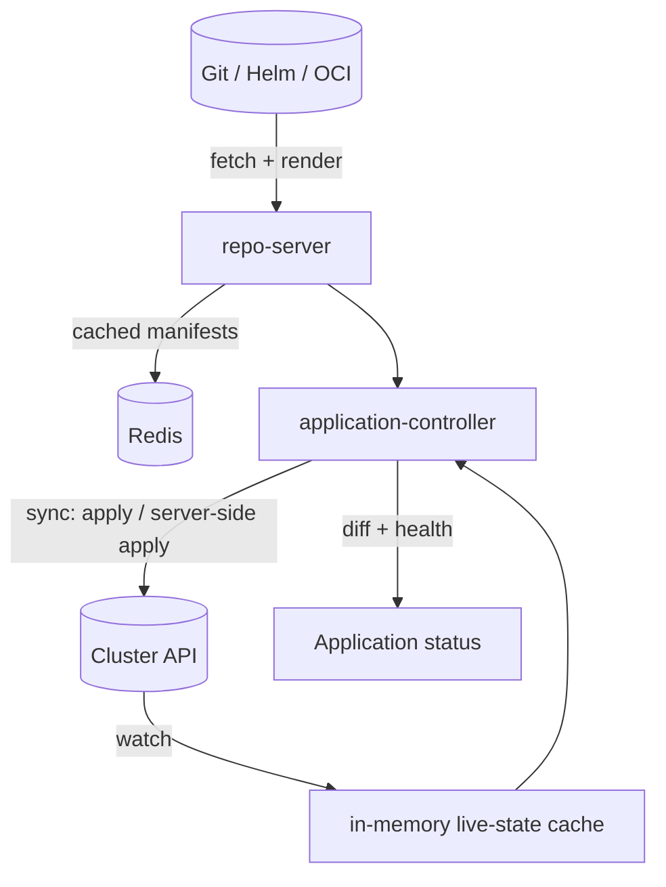

# Argo CD Reconciliation and Drift Detection

## Purpose
Argo CD continuously compares manifests rendered from Git with live objects and reports `Synced`/`OutOfSync` and health. Knowing which component does what — and how the diff is computed — is what lets you fix permanent OutOfSync, slow reconciliation, and unsafe auto-sync.

## Agent Protocol

### Trigger
"argocd reconciliation", "drift detection", "OutOfSync", "argocd diff", "ignoreDifferences", "server-side diff", "sync waves", "refresh vs sync", "application controller".

### Input Context
- Argo CD version, number of Applications/clusters.
- The resource and field that shows a diff; sync options in use.
- Mutating webhooks/operators that modify the resource (HPA, Istio injection, cert-manager, defaulting).

### Output Artifact
Diagnosis plus Application/ConfigMap changes. No file unless requested.

### Response Format
```
Symptom: {OutOfSync on <kind>/<field> | slow refresh | sync failure}
Cause: {defaulted field|mutating webhook|controller-owned field|generator drift}
Fix: {ignoreDifferences|ServerSideDiff|RespectIgnoreDifferences|manifest change}
Snippet: {YAML}
```

### Completion Criteria
- [ ] Root cause identified as a specific field and its writer.
- [ ] Fix scoped to that field (no blanket ignores of whole resources).

## Components
| Component | Role |
|---|---|
| `argocd-repo-server` | Clones Git/OCI/Helm repos and renders manifests (Helm template, Kustomize build, plain YAML, config management plugins). Results cached (in Redis) by revision + parameters. |
| `argocd-application-controller` | Keeps a **per-cluster in-memory cache of live resources** built with Kubernetes watches; compares rendered manifests to live state; runs syncs; computes health. Sharded across replicas by cluster. |
| `argocd-server` | API/UI; triggers refresh/sync. |
| Redis | Cache for rendered manifests and app-state snapshots shown in the UI — not the source of the live-state cache. |
| `argocd-applicationset-controller` | Generates Applications from generators. |



## Reconciliation Timing
- Repo polling: `timeout.reconciliation` in `argocd-cm` (default `180s`, jitter added in recent versions via `timeout.reconciliation.jitter`). Configure Git webhooks to the Argo CD server for near-instant refresh.
- **Refresh** = re-render from Git and re-diff. **Hard refresh** = also bypass the manifest cache. **Sync** = apply desired state.
- Live-state changes arrive via watches immediately; the controller re-diffs affected apps without waiting for the polling interval.

## How the Diff Works
1. Desired manifests are normalized (defaults that Argo CD knows about, `ignoreDifferences` rules, known-type normalizers).
2. Compared with live object:
   - **Legacy client-side diff**: three-way using the `kubectl.kubernetes.io/last-applied-configuration` annotation. Fields not in Git and set by others are not reported, but defaulted values for fields you *do* set (e.g. `resources: {}`) can show diffs.
   - **Server-side diff** (`argocd.argoproj.io/compare-options: ServerSideDiff=true` or globally `controller.diff.server.side: "true"`): does a dry-run server-side apply and compares the result, so API-server defaulting and mutating webhooks are accounted for. Recommended for new setups.
3. Health is computed separately (built-in health checks + Lua custom checks).

## Fixing Spurious OutOfSync

```yaml
apiVersion: argoproj.io/v1alpha1
kind: Application
metadata:
  name: checkout
  namespace: argocd
  annotations:
    argocd.argoproj.io/compare-options: ServerSideDiff=true
spec:
  project: payments
  source:
    repoURL: https://github.com/example/platform-config.git
    targetRevision: main
    path: apps/checkout/overlays/prod
  destination:
    server: https://kubernetes.default.svc
    namespace: checkout
  ignoreDifferences:
    - group: apps
      kind: Deployment
      jsonPointers:
        - /spec/replicas                 # owned by HPA
    - group: admissionregistration.k8s.io
      kind: MutatingWebhookConfiguration
      jqPathExpressions:
        - .webhooks[]?.clientConfig.caBundle   # injected by cert-manager
    - group: "*"
      kind: "*"
      managedFieldsManagers:
        - kube-controller-manager        # ignore fields owned by this manager
  syncPolicy:
    automated:
      prune: true
      selfHeal: true
    syncOptions:
      - ServerSideApply=true
      - RespectIgnoreDifferences=true    # don't overwrite ignored fields on sync
      - ApplyOutOfSyncOnly=true
```
Better fixes before ignoring: remove `spec.replicas` from Git when an HPA owns it; set fields explicitly to what the API server defaults.

## Sync Ordering and Hooks
- `argocd.argoproj.io/sync-wave: "-1"` — lower waves apply first; Argo CD waits for health of each wave.
- Hooks: `argocd.argoproj.io/hook: PreSync|Sync|PostSync|SyncFail` (e.g. DB migration Job in PreSync) with `argocd.argoproj.io/hook-delete-policy: BeforeHookCreation|HookSucceeded`.
- CRDs before CRs: put CRDs in an earlier wave or use `SkipDryRunOnMissingResource=true` on the CRs.

## Self-Heal and Prune Safety
- `selfHeal: true` reverts manual changes (drift) automatically; `prune: true` deletes resources removed from Git.
- Protect critical resources with `argocd.argoproj.io/sync-options: Prune=false` or `Delete=false` (PVCs, namespaces).
- Resource tracking: prefer `application.resourceTrackingMethod: annotation` (default since Argo CD 3.0) over label tracking to avoid collisions with other tools' `app.kubernetes.io/instance` labels.

## Anti-Patterns
- Blanket `ignoreDifferences` on `/spec` — hides real drift.
- Helm charts generating random values (`randAlphaNum` passwords, timestamps) → perpetual OutOfSync; use pre-created Secrets.
- Very low `timeout.reconciliation` across thousands of apps instead of webhooks → repo-server overload.
- Manual `kubectl edit` with self-heal disabled and no alerting.

## Checklist
- [ ] Git webhooks configured; reconciliation timeout left at default or higher.
- [ ] Server-side diff/apply enabled for apps with webhooks or operators.
- [ ] `ignoreDifferences` limited to specific pointers/managers + `RespectIgnoreDifferences`.
- [ ] Sync waves for ordering; hooks for migrations.
- [ ] Notifications on `OutOfSync` > N minutes and on `Degraded`.

## References
- Related skills: `skills/cloud-native/gitops-workflows/SKILL.md`, `skills/devops/argo-cd/SKILL.md`, `skills/devops/gitops-advanced/SKILL.md`.
