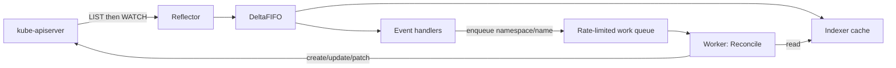

# Kubernetes Operators and the Controller Pattern

## Purpose
An operator is a custom controller plus a CRD that encodes operational knowledge (provisioning, upgrades, failover, backup) as code. This skill explains how the machinery works so designs are level-triggered, idempotent, and cheap on the API server — and so teams only build an operator when Helm/Kustomize is genuinely insufficient.

## Agent Protocol

### Trigger
"how do operators work", "reconciliation loop", "informer", "work queue", "controller pattern", "level-triggered", "CRD basics", "should I write an operator", "operator vs helm".

### Input Context
- What the operator must manage (stateful app, external cloud resource, policy).
- Day-2 operations required (upgrade, backup, scaling, failover).
- Team language/tooling (Go + controller-runtime, Java Operator SDK, kopf for Python).

### Output Artifact
Design explanation, CRD spec/status shape, reconcile outline. No file unless requested.

### Response Format
```
Build an operator?: {yes|no} (why)
CRD: {group/version/kind}, spec fields, status conditions
Watches: {primary kind} + owns {child kinds}
Reconcile steps: {ordered, idempotent}
Cleanup: {ownerReferences|finalizer for external resources}
```

### Completion Criteria
- [ ] Reconcile is idempotent and works from current state only (no event payload reliance).
- [ ] Status reports `observedGeneration` and Conditions.
- [ ] External resources cleaned up through a finalizer.

## Do You Need an Operator?
| Situation | Answer |
|---|---|
| Install + configure stateless app | No — Helm/Kustomize |
| Stateful system with failover, backups, version upgrades needing ordered steps | Yes — or adopt an existing operator (CloudNativePG, Strimzi, Prometheus Operator) |
| Provision cloud resources from K8s | Usually use Crossplane / AWS Controllers for Kubernetes / Config Connector instead of writing one |
| One-off migration | No — a Job |

## Mechanics


1. **Reflector** does an initial LIST, then a WATCH from the returned `resourceVersion`; on `410 Gone` (history compacted) it relists.
2. **Indexer** is a local, thread-safe cache; reads in Reconcile hit the cache, not the API server.
3. **Event handlers** only enqueue a key (`namespace/name`). The work queue de-duplicates keys, so 50 rapid updates become one reconcile.
4. **Workers** pop keys and call Reconcile. Errors → requeue with exponential backoff (rate-limited queue). Success → `Forget`.
5. **Resync** periodically re-delivers all cached objects to catch missed external drift.

### Level-triggered, not edge-triggered
Reconcile receives only a name. It must fetch current desired state (spec) and observed state, compute the difference, and act. Never depend on "what changed" — events can be coalesced or missed.

## Reconcile Outline (controller-runtime, Go)

```go
func (r *CacheReconciler) Reconcile(ctx context.Context, req ctrl.Request) (ctrl.Result, error) {
	log := logf.FromContext(ctx)

	var cache cachev1.Cache
	if err := r.Get(ctx, req.NamespacedName, &cache); err != nil {
		return ctrl.Result{}, client.IgnoreNotFound(err) // deleted: children GC'd via ownerRefs
	}

	desired := buildStatefulSet(&cache) // pure function of spec
	if err := controllerutil.SetControllerReference(&cache, desired, r.Scheme); err != nil {
		return ctrl.Result{}, err
	}

	var existing appsv1.StatefulSet
	err := r.Get(ctx, client.ObjectKeyFromObject(desired), &existing)
	switch {
	case apierrors.IsNotFound(err):
		log.Info("creating statefulset", "name", desired.Name)
		if err := r.Create(ctx, desired); err != nil {
			return ctrl.Result{}, err
		}
	case err != nil:
		return ctrl.Result{}, err
	default:
		existing.Spec.Replicas = desired.Spec.Replicas
		existing.Spec.Template = desired.Spec.Template
		if err := r.Update(ctx, &existing); err != nil {
			return ctrl.Result{}, err // conflict → requeued with backoff
		}
	}

	meta.SetStatusCondition(&cache.Status.Conditions, metav1.Condition{
		Type: "Ready", Status: metav1.ConditionTrue, Reason: "Reconciled",
		ObservedGeneration: cache.Generation,
	})
	cache.Status.ObservedGeneration = cache.Generation
	return ctrl.Result{}, r.Status().Update(ctx, &cache)
}

func (r *CacheReconciler) SetupWithManager(mgr ctrl.Manager) error {
	return ctrl.NewControllerManagedBy(mgr).
		For(&cachev1.Cache{}).
		Owns(&appsv1.StatefulSet{}). // child changes requeue the owner
		Complete(r)
}
```
Imports: `appsv1 "k8s.io/api/apps/v1"`, `apierrors "k8s.io/apimachinery/pkg/api/errors"`, `"k8s.io/apimachinery/pkg/api/meta"`, `metav1 "k8s.io/apimachinery/pkg/apis/meta/v1"`, `ctrl "sigs.k8s.io/controller-runtime"`, `"sigs.k8s.io/controller-runtime/pkg/client"`, `"sigs.k8s.io/controller-runtime/pkg/controller/controllerutil"`, `logf "sigs.k8s.io/controller-runtime/pkg/log"`.

## Key Building Blocks
| Concept | Purpose |
|---|---|
| `spec` vs `status` subresource | Users write spec; controller writes status; status updates don't bump `generation` |
| `metadata.generation` / `status.observedGeneration` | Tell clients whether the latest spec has been processed |
| Conditions (`Ready`, `Progressing`, `Degraded`) | Standard machine-readable health |
| Owner references | Garbage collector deletes children when owner is deleted |
| Finalizers | Block deletion until external cleanup (cloud resources, backups) completes |
| Optimistic concurrency (`resourceVersion`) | Update conflicts return 409; requeue and retry on fresh state |
| Leader election | Only one replica reconciles at a time |
| Server-side apply | Field ownership; avoids clobbering fields owned by others |

## Anti-Patterns
- Reading from the API server directly in hot loops instead of the cache.
- Writing status into spec, or spec from the controller (fights with GitOps).
- Long blocking work inside Reconcile (minutes) → use Jobs and requeue with `RequeueAfter`.
- Missing finalizer for external resources → orphaned cloud resources.
- Watching all Secrets/ConfigMaps cluster-wide without label selectors → large memory cache.

## Checklist
- [ ] Idempotent, level-triggered Reconcile.
- [ ] Status conditions + `observedGeneration`.
- [ ] Owner references on children; finalizer for externals.
- [ ] RBAC limited to watched/owned kinds.
- [ ] Metrics (`controller_runtime_reconcile_errors_total`) and alerting.

## References
- Related skills: `skills/devops/kubernetes-operators/SKILL.md`, `skills/cloud-native/kubernetes-mastery/SKILL.md`, `skills/devops/kubernetes-internals/SKILL.md`.
