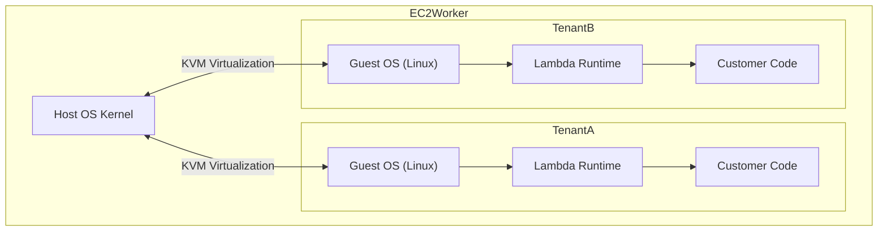

# Firecracker MicroVM & Serverless Execution

AWS Lambda does not run your code in a standard Docker container on a shared kernel. To achieve multi-tenant security, it runs your code inside a specialized lightweight virtual machine called **Firecracker**.

## The Virtualization Boundary

## Cold Start Timeline
1. **VM Provisioning**: Firecracker boots a tiny Linux guest OS (taking < 125ms).
2. **Runtime Boot**: The language runtime (e.g., Node.js V8 engine, Java JVM) initializes. This is heavily dependent on the runtime size.
3. **Init Code Execution**: Any code located *outside* your `exports.handler = async () => {}` function is executed.
4. **Invocation**: The actual handler runs.

**Billing note**: Since 1 August 2025 the INIT phase is billed for on-demand functions on managed runtimes (ZIP), the same as it already was for container images and custom runtimes. Heavy init code now costs money as well as latency. Do not rely on undocumented CPU boosts during init.
