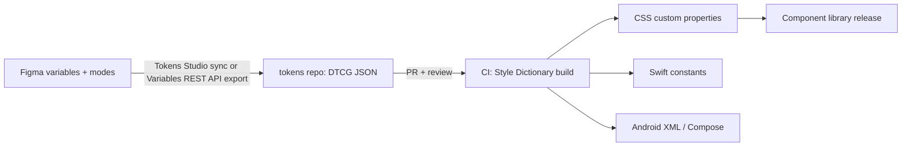

# Design Systems (Design ↔ Code Workflow)

## Purpose
A design system is a product: tokens, components, patterns, documentation and the process that keeps design files and code in sync. This skill defines the token architecture, the automated pipeline from Figma variables to platform code, component specs that engineers can implement without guessing, and the governance that keeps the system alive.

## Agent Protocol

### Trigger
"design system", "design tokens", "Figma variables", "Figma to code", "Style Dictionary", "Tokens Studio", "DTCG", "component spec", "design system governance", "adoption".

### Input Context
- Design tool (Figma variables/styles, Tokens Studio plugin) and where tokens live today.
- Target platforms (web CSS, iOS, Android, Flutter) and theming needs (brands, dark mode, density).
- Team size, consumers (number of products), current pain (drift, duplicated components).

### Output Artifact
Token taxonomy + example token files, pipeline config, component spec template, governance process.

### Response Format
```
Tiers: primitive -> semantic -> component
Source of truth: {Figma variables|tokens repo}
Pipeline: {export step} -> {Style Dictionary build} -> {platform outputs}
Modes/themes: {light, dark, brand-x}
Governance: {owner, contribution flow, release cadence}
```

## Token Architecture

| Tier | Example | Who uses it |
|------|---------|-------------|
| Primitive (option) | `color.blue.600 = #2563eb`, `space.4 = 16px` | Only semantic tokens |
| Semantic (decision) | `color.action.primary.bg = {color.blue.600}` | Components and product code |
| Component | `button.primary.bg = {color.action.primary.bg}` | One component, optional |

Rules:
- Product code references semantic tokens only; primitives are never used directly in components.
- Themes and dark mode swap **semantic** values (modes), not component code.
- Name by purpose (`text.subtle`, `border.danger`), never by value (`grey-light`).

## Token File (W3C DTCG format)
The Design Tokens Community Group format uses `$value`, `$type`, `$description` and `{alias}` references; its first stable version was published in 2025 and Style Dictionary v4+ and Tokens Studio read it.

```json
{
  "color": {
    "blue": {
      "600": { "$type": "color", "$value": "#2563eb" },
      "700": { "$type": "color", "$value": "#1d4ed8" }
    },
    "action": {
      "primary": {
        "bg": { "$type": "color", "$value": "{color.blue.600}", "$description": "Primary button and link background" },
        "bg-hover": { "$type": "color", "$value": "{color.blue.700}" }
      }
    }
  },
  "space": {
    "4": { "$type": "dimension", "$value": "16px" }
  }
}
```
(Newer spec drafts also allow structured values such as `{ "colorSpace": "srgb", "components": [...] }` for colors and `{ "value": 16, "unit": "px" }` for dimensions; check what your tooling version supports.)

## Pipeline: Figma → Code


- Keep tokens in git; Figma is the authoring tool, the repo is the reviewed source of truth.
- Figma's Variables REST API requires an Enterprise plan; otherwise use the Tokens Studio plugin (syncs to GitHub/GitLab) or a Figma plugin export.

```js
// style-dictionary.config.mjs (Style Dictionary v4/v5)
export default {
  source: ['tokens/**/*.json'],
  platforms: {
    css: {
      transformGroup: 'css',
      buildPath: 'dist/css/',
      files: [{ destination: 'tokens.css', format: 'css/variables', options: { outputReferences: true } }],
    },
    ios: {
      transformGroup: 'ios-swift',
      buildPath: 'dist/ios/',
      files: [{ destination: 'Tokens.swift', format: 'ios-swift/class', options: { className: 'Tokens' } }],
    },
  },
};
```
Run with `npx style-dictionary build --config style-dictionary.config.mjs`. `outputReferences` keeps semantic tokens as `var(--color-blue-600)` references so theme overrides cascade.

## Component Spec Template
Every component handed to engineering includes:
1. **Anatomy**: named parts (container, label, icon-leading, icon-trailing).
2. **Variants & props**: `variant: primary|secondary|ghost`, `size: sm|md|lg`, `disabled`, `loading`.
3. **States**: default, hover, focus-visible, active, disabled, loading, error — each mapped to tokens.
4. **Tokens used** per part and state.
5. **Behaviour & a11y**: keyboard interaction, ARIA role/pattern, focus order, minimum target size (WCAG 2.2 AA: 24×24 CSS px).
6. **Content guidelines**: label length, truncation, localisation expansion.
7. **Do / Don't** examples.

## Governance
| Element | Practice |
|---------|----------|
| Ownership | Core team owns primitives/semantics and core components; product teams contribute |
| Contribution | Proposal → design review → a11y review → build → docs → release |
| Versioning | Semver for packages; breaking token renames ship with codemods/aliases for one major |
| Deprecation | Mark deprecated in Figma + code (`$deprecated` in DTCG), remove next major |
| Cadence | Regular releases with changelog; Figma library publish in sync with package release |

## Metrics
- Adoption: % of product UI built from system components (scan imports / Figma library analytics).
- Detached instances in Figma and hardcoded colors in code (lint with stylelint rules / token linters).
- Time to ship a new component; open contribution requests.
- Accessibility defects attributed to system components.

## Anti-patterns
| Anti-pattern | Fix |
|--------------|-----|
| Tokens named by value (`blue-button`) | Purpose-based semantic names |
| Components consuming primitives | Insert semantic layer |
| Manual copy of hex values from Figma | Automated token pipeline in CI |
| Figma and code released independently | Shared release cadence and changelog |
| Building every requested variant | Contribution criteria: used by 2+ products |

## Checklist
- [ ] Three-tier token taxonomy documented.
- [ ] Tokens in DTCG JSON under version control.
- [ ] Style Dictionary (or equivalent) builds all platforms in CI.
- [ ] Themes implemented as semantic modes.
- [ ] Component spec template used for every component.
- [ ] Governance, versioning and deprecation process published.
- [ ] Adoption and drift metrics tracked.

## References
- `references/design-systems-fundamentals.md`
- `references/design-systems-advanced.md`
- `references/design-tokens.md`
- `references/design-system-tokens.md`
- `references/component-library.md`
- `references/design-system-workflow.md`
- `references/design-system-governance.md`
- `references/design-system-accessibility.md`
