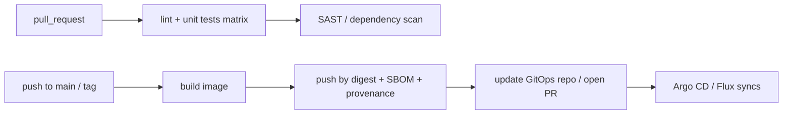

# GitHub Actions CI/CD Pipeline Architecture

## Purpose
Build a pipeline that is fast (parallel matrix, deterministic caches), secure (no long-lived cloud keys, least-privilege `GITHUB_TOKEN`, pinned actions), and modular (reusable workflows shared across repos), ending with an immutable image and a GitOps commit rather than `kubectl apply` from CI.

## Agent Protocol

### Trigger
"github actions pipeline", "reusable workflow", "workflow_call", "matrix build", "actions cache", "oidc aws github", "build and push image", "gitops update from ci", "secure github actions".

### Input Context
- Language/toolchain, monorepo or polyrepo, test duration.
- Cloud + registry (ECR, GAR, ACR, GHCR), deploy model (GitOps vs direct).
- Org policies (allowed actions, required reviewers, environments).

### Output Artifact
Workflow YAML files and cloud trust configuration. No file unless requested.

### Response Format
```
Workflows: {ci.yml (PR), release.yml (main/tag), reusable/*.yml}
Auth: {OIDC role/identity, permissions block}
Caching: {setup-* cache | actions/cache key}
Artifact: {image ref by digest, SBOM/provenance}
Deploy: {GitOps PR/commit | environment-gated job}
```

### Completion Criteria
- [ ] Top-level `permissions:` minimal; elevated per job only.
- [ ] No static cloud credentials; OIDC trust scoped to repo + ref/environment.
- [ ] Third-party actions pinned to full commit SHA.
- [ ] Cache keys derived from lockfile hashes.

## Pipeline Shape


## CI Workflow (PR)
```yaml
name: ci
on:
  pull_request:
  push:
    branches: [main]
permissions:
  contents: read
concurrency:
  group: ci-${{ github.workflow }}-${{ github.ref }}
  cancel-in-progress: true
jobs:
  test:
    runs-on: ${{ matrix.os }}
    timeout-minutes: 20
    strategy:
      fail-fast: false
      matrix:
        node: [20, 22]
        os: [ubuntu-latest]
        include:
          - node: 22
            os: windows-latest
    steps:
      - uses: actions/checkout@v4          # pin to a full SHA in production
      - uses: actions/setup-node@v4
        with:
          node-version: ${{ matrix.node }}
          cache: npm                        # keyed on package-lock.json
      - run: npm ci
      - run: npm test -- --ci
```
`include` adds one extra combination (Node 22 on Windows) without multiplying the whole matrix.

## Reusable Workflow
```yaml
# .github/workflows/build-image.yml (in a shared repo or the same repo)
name: build-image
on:
  workflow_call:
    inputs:
      image:
        type: string
        required: true
    outputs:
      digest:
        value: ${{ jobs.build.outputs.digest }}
permissions:
  contents: read
jobs:
  build:
    runs-on: ubuntu-latest
    permissions:
      contents: read
      id-token: write        # OIDC token for cloud auth + keyless signing
      packages: write        # only if pushing to GHCR
      attestations: write
    outputs:
      digest: ${{ steps.push.outputs.digest }}
    steps:
      - uses: actions/checkout@v4
      - uses: aws-actions/configure-aws-credentials@v4
        with:
          role-to-assume: arn:aws:iam::123456789012:role/gha-ecr-push
          aws-region: eu-west-1
      - uses: aws-actions/amazon-ecr-login@v2
        id: ecr
      - uses: docker/setup-buildx-action@v3
      - uses: docker/build-push-action@v6
        id: push
        with:
          push: true
          tags: ${{ steps.ecr.outputs.registry }}/${{ inputs.image }}:${{ github.sha }}
          cache-from: type=gha
          cache-to: type=gha,mode=max
          sbom: true
          provenance: mode=max
      - uses: actions/attest-build-provenance@v2
        with:
          subject-name: ${{ steps.ecr.outputs.registry }}/${{ inputs.image }}
          subject-digest: ${{ steps.push.outputs.digest }}
          push-to-registry: true
```
Caller:
```yaml
jobs:
  image:
    uses: example-org/platform-workflows/.github/workflows/build-image.yml@v3
    with: { image: checkout }
    permissions: { contents: read, id-token: write, packages: write, attestations: write }
```
A called workflow can't get more permissions than the caller grants.

## OIDC Trust (AWS)
```json
{
  "Effect": "Allow",
  "Principal": { "Federated": "arn:aws:iam::123456789012:oidc-provider/token.actions.githubusercontent.com" },
  "Action": "sts:AssumeRoleWithWebIdentity",
  "Condition": {
    "StringEquals": {
      "token.actions.githubusercontent.com:aud": "sts.amazonaws.com",
      "token.actions.githubusercontent.com:sub": "repo:example-org/checkout:ref:refs/heads/main"
    }
  }
}
```
Use `repo:org/repo:environment:production` subjects for environment-gated deploy jobs. Never use a wildcard like `repo:example-org/*`.

## GitOps Update Step
```yaml
  promote-dev:
    needs: image
    runs-on: ubuntu-latest
    environment: dev
    steps:
      - uses: actions/checkout@v4
        with:
          repository: example-org/platform-config
          token: ${{ secrets.CONFIG_REPO_TOKEN }}   # fine-grained PAT or GitHub App token, contents:write on that repo only
      - run: |
          cd apps/checkout/overlays/dev
          kustomize edit set image checkout=123456789012.dkr.ecr.eu-west-1.amazonaws.com/checkout@${{ needs.image.outputs.digest }}
          git config user.name "ci-bot"; git config user.email "ci-bot@users.noreply.github.com"
          git commit -am "checkout: deploy ${{ github.sha }} to dev" && git push
```
Prefer a GitHub App installation token (`actions/create-github-app-token`) over a PAT.

## Security Hardening
- Pin third-party actions to commit SHAs (Dependabot/Renovate can update them).
- `pull_request_target` runs with secrets in the base repo context — never check out and run PR code in it.
- Treat `${{ github.event.* }}` strings (PR titles, branch names) as untrusted; pass via `env:` instead of inline `run:` interpolation to avoid script injection.
- Use environments with required reviewers for production; restrict which branches can deploy.
- Self-hosted runners: ephemeral (one job per runner, e.g. Actions Runner Controller) and never on public repos.

## Anti-Patterns
- `permissions: write-all` or no `permissions` block on repos where default token is write.
- Long-lived `AWS_ACCESS_KEY_ID` secrets.
- Cache keys without lockfile hash → stale/poisoned caches.
- Deploying with `kubectl apply` from CI using cluster-admin kubeconfig.
- Tagging images `latest` and deploying the tag.

## Checklist
- [ ] Minimal `permissions`, concurrency group, job timeouts.
- [ ] OIDC roles per repo/environment.
- [ ] Actions pinned by SHA; Dependabot for `github-actions` ecosystem.
- [ ] Image pushed by digest with SBOM + provenance attestation.
- [ ] GitOps commit/PR as the deploy step; prod gated by environment reviewers.

## References
- Related skills: `skills/devops/github-actions/SKILL.md`, `skills/devops/cicd-pipeline/SKILL.md`, `skills/devops/ci-cd/gitops-argocd/SKILL.md`.
