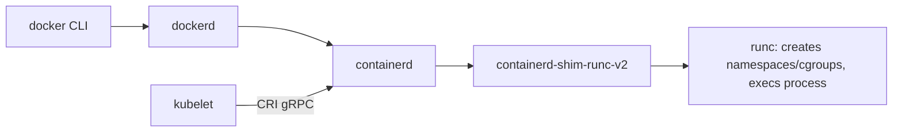

# Docker and Container Internals

## Purpose
A container is an ordinary Linux process tree started with isolated namespaces, constrained by cgroups, with reduced privileges, and a root filesystem assembled from image layers. Knowing this explains OOM kills, PID 1 signal problems, file-change behaviour, and what "privileged" really grants.

## Agent Protocol

### Trigger
"how do containers work", "docker internals", "namespaces", "cgroups", "overlayfs", "copy on write", "containerd", "runc", "OCI runtime", "PID 1", "OOM killed".

### Input Context
- Host OS/kernel, cgroup version (`stat -fc %T /sys/fs/cgroup` → `cgroup2fs` means v2).
- Runtime (Docker Engine, containerd via Kubernetes, Podman).
- Symptom being debugged.

### Output Artifact
Explanation + inspection commands + fix. No file unless requested.

### Response Format
```
Mechanism: {namespace|cgroup|capability|seccomp|overlayfs|runtime}
Evidence: {commands and expected output}
Explanation: {...}
Fix: {run flags / Dockerfile / K8s field}
```

### Completion Criteria
- [ ] Symptom mapped to a specific kernel mechanism.
- [ ] Inspection commands given to confirm.

## Runtime Stack

- Images and runtimes follow the OCI Image and Runtime specs; any OCI image runs on containerd/CRI-O/Podman.
- Kubernetes removed dockershim in 1.24; kubelet talks CRI to containerd or CRI-O directly. Images built with Docker still work.
- The shim keeps containers running when containerd/dockerd restart.

## Namespaces (isolation of what a process can see)
| Namespace | Isolates |
|---|---|
| PID | Process IDs (container's first process is PID 1) |
| NET | Interfaces, routes, iptables, ports |
| MNT | Mount table / root filesystem |
| UTS | Hostname, domain name |
| IPC | SysV IPC, POSIX message queues |
| USER | UID/GID mapping (root in container → unprivileged on host when used) |
| CGROUP | View of the cgroup hierarchy |
| TIME | CLOCK_MONOTONIC/BOOTTIME offsets (kernel ≥ 5.6) |
Inspect: `lsns`, `ls -l /proc/<pid>/ns`, enter with `nsenter -t <pid> -n -m ...`.

## cgroups v2 (limits on what a process can use)
- Memory: `memory.max` (hard limit → OOM kill of a process in the cgroup), `memory.high` (throttling/reclaim). Docker `--memory` sets `memory.max`. Check `memory.events` for `oom_kill` counts.
- CPU: `cpu.max` = quota/period (Docker `--cpus=1.5` → `150000 100000`); exceeding quota causes throttling (`cpu.stat` → `nr_throttled`). `cpu.weight` sets relative share under contention.
- PIDs: `pids.max` stops fork bombs (`--pids-limit`).
- I/O: `io.max` for bandwidth/IOPS limits.
Most current distributions default to cgroup v2; runtimes need the systemd cgroup driver configured consistently with the kubelet.

## Privileges
- **Capabilities**: Docker drops most capabilities by default; `--cap-drop=ALL --cap-add=NET_BIND_SERVICE` for minimal sets.
- **seccomp**: default profile blocks dangerous syscalls (e.g. `kexec_load`, `mount` in most cases).
- **`--privileged`**: all capabilities, all devices, no seccomp/AppArmor confinement — effectively root on the host. Avoid.
- **Rootless / user namespaces**: Docker rootless mode, Podman rootless, Kubernetes `hostUsers: false`.

## Image Layers and OverlayFS
- Each Dockerfile instruction that changes the filesystem creates a layer (a tar diff), content-addressed by digest.
- At runtime, `overlay2` stacks read-only lower layers + one writable upper layer; reads fall through to the topmost layer containing the file.
- Modifying a lower-layer file triggers **copy-up** of the whole file to the upper layer (expensive for big files); deleting creates a whiteout file.
- Deleting a file in a later layer does not shrink the image — the earlier layer still contains it. Clean up in the same `RUN` or use multi-stage builds.
- Write-heavy data (databases, logs) belongs in volumes, which bypass OverlayFS.

## PID 1 Behaviour
- The kernel doesn't apply default signal handlers to PID 1 in a namespace: if the app doesn't handle SIGTERM, `docker stop` waits for the timeout then SIGKILLs.
- PID 1 must reap zombie children. Use `docker run --init` (tini) or `tini`/`dumb-init` as entrypoint for apps that spawn children.
- Use exec-form `ENTRYPOINT ["app"]`; shell form runs `/bin/sh -c` as PID 1, which doesn't forward signals.

## Debugging Recipes
```bash
docker inspect --format '{{.State.Pid}} {{.State.OOMKilled}}' <ctr>
cat /sys/fs/cgroup/system.slice/docker-<id>.scope/memory.events      # path varies by driver
docker stats --no-stream
nsenter -t "$(docker inspect -f '{{.State.Pid}}' <ctr>)" -n ss -tlnp   # sockets inside netns
docker run --rm -it --pid=container:<ctr> --net=container:<ctr> nicolaka/netshoot  # debug sidecar
```

## Anti-Patterns
- `--privileged` or mounting `/var/run/docker.sock` into app containers (host root).
- Memory limit without matching runtime settings (JVM/Node heap) → OOM kills.
- Running as root by default; add `USER` in Dockerfile.
- Expecting `RUN rm` to shrink images.

## Checklist
- [ ] Non-root user, dropped capabilities, default seccomp, read-only root FS where possible.
- [ ] Memory/CPU/PID limits set; runtime heap tuned to limits.
- [ ] Exec-form entrypoint; init process when children are spawned.
- [ ] Persistent/write-heavy data on volumes.

## References
- Related skills: `skills/devops/docker/SKILL.md`, `skills/devops/docker-patterns/SKILL.md`, `skills/devops/orchestration/kubernetes-architecture/SKILL.md`.
