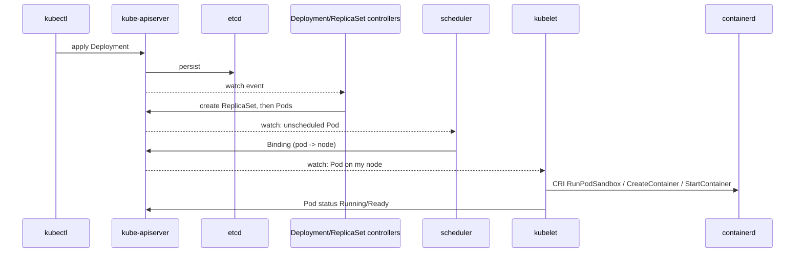

# Kubernetes Architecture and Deployment Strategies

## Purpose
Give an accurate mental model of the Kubernetes control plane and node components and how they cooperate through the API server, then map release requirements to a deployment strategy.

## Agent Protocol

### Trigger
"kubernetes architecture", "control plane", "kubelet", "kube-proxy modes", "etcd", "how a pod is scheduled", "deployment strategies", "rolling vs blue green vs canary".

### Input Context
- Managed (EKS/GKE/AKS) or self-managed; cluster version.
- Release risk tolerance, traffic management available (ingress/Gateway API, mesh).

### Output Artifact
Explanation and strategy recommendation with manifests. No file unless requested.

### Response Format
```
Component(s): {...} — responsibility
Flow: {kubectl -> apiserver -> etcd -> controller -> scheduler -> kubelet -> CRI}
Strategy: {RollingUpdate|Recreate|blue/green|canary} (why)
Config: {YAML}
```

### Completion Criteria
- [ ] Every component described by what it watches and what it writes.
- [ ] Strategy matches rollback-time and capacity constraints.

## Components
| Component | Runs on | Responsibility |
|---|---|---|
| kube-apiserver | Control plane | Only component that talks to etcd; authn → authz → admission → validation → persistence; serves watches |
| etcd | Control plane (or external) | Consistent key-value store (Raft) for all cluster state; odd member count (3/5) |
| kube-scheduler | Control plane | Watches unscheduled pods; filters and scores nodes; writes a Binding |
| kube-controller-manager | Control plane | Built-in controllers (Deployment, ReplicaSet, Node, Job, EndpointSlice, ServiceAccount, ...) |
| cloud-controller-manager | Control plane | Cloud-specific: load balancers, node lifecycle, routes |
| kubelet | Every node | Watches pods bound to its node; drives the container runtime via CRI; runs probes; reports status |
| Container runtime | Every node | containerd or CRI-O (+ runc/crun) |
| kube-proxy | Every node (optional) | Programs Service virtual IP routing: `iptables`, `ipvs`, or `nftables` mode (nftables GA in 1.33); can be replaced by Cilium eBPF |
| CNI plugin | Every node | Pod IPs and pod-to-pod networking (Calico, Cilium, AWS VPC CNI, ...) |
| CoreDNS | Cluster add-on | Service discovery DNS |

All components communicate with the API server over HTTPS (watch/list/update); none talk to each other directly (the apiserver does call kubelets for `logs`, `exec`, `port-forward`). The kubelet ↔ runtime link is CRI over gRPC on a local socket.

## From `kubectl apply` to Running Pod


## Deployment Strategies
| Strategy | Mechanism | Rollback | Extra capacity | Fit |
|---|---|---|---|---|
| RollingUpdate (default) | Replace pods gradually (`maxSurge`, `maxUnavailable`) | `kubectl rollout undo` (minutes) | Up to `maxSurge` | Backward-compatible changes |
| Recreate | Kill all, then start new | Redeploy | None | Can't run two versions at once (schema locks) — causes downtime |
| Blue/green | Two full Deployments; switch Service selector or route | Instant switch back | 2× during release | Need instant rollback, pre-release verification |
| Canary | Small % of traffic to new version, increase on good metrics | Shift traffic back | Small | Risky changes with good metrics; use Argo Rollouts/Flagger + ingress/Gateway API/mesh |

```yaml
# Rolling update that never drops below desired capacity
spec:
  replicas: 6
  minReadySeconds: 10
  progressDeadlineSeconds: 600
  strategy:
    type: RollingUpdate
    rollingUpdate:
      maxSurge: 25%
      maxUnavailable: 0
```
Readiness probes gate rolling updates — without them, Kubernetes considers pods ready as soon as containers start.

Blue/green by selector switch:
```bash
kubectl patch service checkout -p '{"spec":{"selector":{"app":"checkout","track":"green"}}}'
```
Plain Services cannot do weighted canaries; replica-ratio canaries (1 of 10 pods) are approximate. Use Gateway API `HTTPRoute` `backendRefs` weights or a mesh for precise percentages.

## Managed vs Self-Managed
Managed services run apiserver/etcd/scheduler/controllers for you; you still own node upgrades (or use managed node groups/Autopilot-style modes), add-ons, and version upgrades within the provider's support window. Kubernetes minor versions get roughly 14 months of upstream patch support; plan at least one minor upgrade per ~4 months to stay current.

## Anti-Patterns
- Treating etcd as an app database or running it with an even number of members.
- No readiness probes → rolling updates send traffic to unready pods.
- Recreate strategy for stateless web apps.
- Directly editing pods managed by a Deployment.

## Checklist
- [ ] Team can explain watch-based reconciliation (components don't call each other).
- [ ] etcd backed up (self-managed) and control plane HA (3 members).
- [ ] Strategy chosen per service; readiness probes + `maxUnavailable: 0` for critical services.
- [ ] Upgrade cadence planned against the support window.

## References
- Related skills: `skills/devops/kubernetes-internals/SKILL.md`, `skills/devops/kubernetes/SKILL.md`, `skills/devops/progressive-delivery/SKILL.md`, `skills/devops/orchestration/docker-internals/SKILL.md`.
