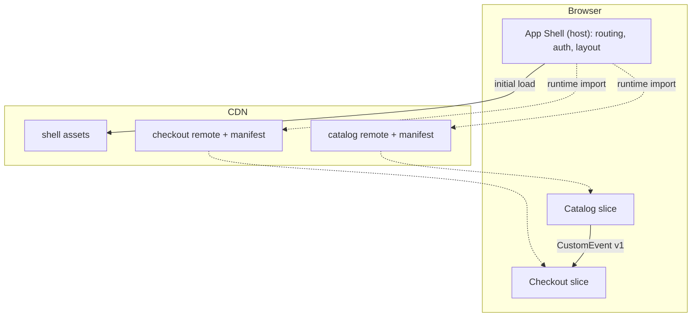

# Micro-frontends Adoption & Composition

## Purpose
Micro-frontends apply microservice ideas to the UI: independently built and deployed slices owned by separate teams and composed into one product. They solve organisational scaling problems (many teams blocked on one release train), not performance problems, and they add runtime, consistency and operational cost. This skill decides if the cost is worth it and which composition style fits.

## Agent Protocol

### Trigger
"micro-frontend", "microfrontend adoption", "split frontend by team", "host/remote", "app shell", "independent frontend deploys".

### Input Context
- Number of teams touching the frontend and their release cadence.
- Frameworks in use (single framework vs. mixed/legacy).
- Hosting: SSR (Next.js, Remix, Nuxt) or static SPA on CDN.
- Pain point: deploy coupling, build time, legacy migration, ownership confusion.

### Output Artifact
Architecture decision (ADR-style) with composition style, slice boundaries and contracts. No files unless requested.

### Response Format
```
Decision: {adopt|defer|reject} micro-frontends
Composition: {build-time|server-side|runtime-MF|iframe|web-components}
Slices: {slice -> owning team -> route/region}
Shared: {design system, auth, routing, telemetry} via {package|runtime singleton}
Contracts: {events, URL params, props schema}
Risks: {top 3}
```

## Decision: Do You Need Micro-frontends?

```
Fewer than ~3 teams on the same UI?            → No. Modular monolith + monorepo (Nx/Turborepo).
Teams blocked by a shared release train?       → Maybe. First try trunk-based dev + feature flags.
Migrating legacy app incrementally (strangler)?→ Yes. Route-level composition is the cheapest path.
Different frameworks must coexist long-term?   → Yes, but prefer route-level split over in-page mixing.
Goal is "faster page loads"?                   → No. MFEs usually add JS and requests.
```

## Composition Styles

| Style | How | Pros | Cons | Use when |
|-------|-----|------|------|----------|
| Build-time (npm packages) | Each slice published as a package, shell bundles them | Simple, type-safe, one optimised bundle | Shell redeploy needed for every change | Teams want ownership but not independent deploys |
| Route-level / server-side | Reverse proxy or edge routes `/checkout/*` to a separate app | Strong isolation, any framework, SSR-friendly | Full page loads between apps, duplicated shell | Strangler migrations, coarse slices |
| Runtime Module Federation | Host loads `remoteEntry.js`/manifest at runtime, shares singletons | Independent deploys, shared React instance | Version skew, runtime failures, complex debugging | Many teams, same framework, in-page composition |
| Web Components | Each slice ships a custom element | Framework-agnostic contract (attributes/events) | SSR and styling (Shadow DOM) friction | Mixed frameworks inside one page |
| iframes | Embed slice as separate document | Hard isolation (security, CSS, JS) | Poor a11y/UX, resizing, deep linking | Third-party or untrusted widgets |

## Boundary Rules
- Slice by business capability and route (catalog, checkout, account), never by technical layer (header team, button team).
- One team owns one slice end-to-end, including its backend-for-frontend.
- A page should be composed of few slices (1-3). Many small remotes per page = latency and coupling.
- Shared code goes into a versioned design-system package, not copied between slices.

## Contracts Between Slices
- **Navigation**: URL is the primary contract. Slices read their own route params; cross-slice navigation uses normal links or a shell-provided `navigate()`.
- **Events**: Browser `CustomEvent` on `window` with namespaced, versioned names.
- **Auth**: Shell owns the session; slices receive a token getter, never read cookies directly.
- **No shared mutable global store** across teams. Each slice owns its state.

```ts
// contracts/events.ts — published as a tiny shared package
export type CartItemAdded = { sku: string; quantity: number };

export function emitCartItemAdded(detail: CartItemAdded): void {
  window.dispatchEvent(new CustomEvent<CartItemAdded>('cart:item-added:v1', { detail }));
}

export function onCartItemAdded(handler: (d: CartItemAdded) => void): () => void {
  const listener = (e: Event) => handler((e as CustomEvent<CartItemAdded>).detail);
  window.addEventListener('cart:item-added:v1', listener);
  return () => window.removeEventListener('cart:item-added:v1', listener);
}
```

## Runtime Failure Handling
A remote can be down while the shell is up. Every remote mount needs an error boundary and a fallback.

```tsx
import { lazy, Suspense } from 'react';
import { ErrorBoundary } from 'react-error-boundary';

const Recommendations = lazy(() => import('recs/Recommendations'));

export function RecommendationsSlot() {
  return (
    <ErrorBoundary fallback={null /* section hidden if remote fails */}>
      <Suspense fallback={<div aria-busy="true" style={{ minHeight: 240 }} />}>
        <Recommendations />
      </Suspense>
    </ErrorBoundary>
  );
}
```

## Architecture Map



## Anti-patterns
| Anti-pattern | Fix |
|--------------|-----|
| Micro-frontends for a 2-team product | Modular monolith with enforced module boundaries |
| Slices sharing a Redux store | Events + URL contracts, each slice owns state |
| Different React versions in one page | Shared singleton with a required version range |
| No fallback when remote fails | Error boundary + feature-hidden fallback |
| Copy-pasted design system per slice | Versioned design-system package, visual regression tests |
| Remote URLs hardcoded in host build | Runtime manifest/config per environment |

## Checklist
- [ ] Organisational reason documented (teams, deploy coupling), not performance.
- [ ] Composition style chosen per table above.
- [ ] Slices aligned to routes/business capabilities.
- [ ] Contracts (URL, events, auth) versioned and published.
- [ ] Error boundaries + fallbacks around every remote.
- [ ] Shared dependencies declared as singletons with version ranges.
- [ ] Per-slice CI/CD, plus an integration smoke test against the composed app.
- [ ] Bundle-size and Web Vitals budgets tracked for the composed page.
