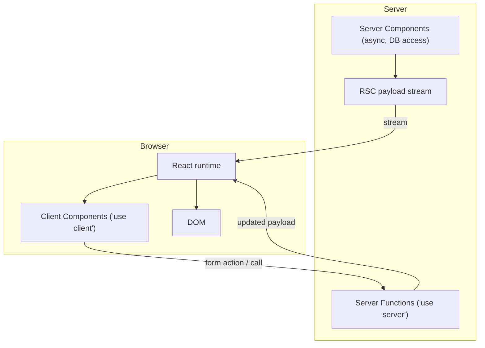

# React Server Components (RSC)

## Purpose
Server Components are a stable part of React 19: components that render ahead of time on the server (per request or at build time) and whose code never ships to the browser. They are used through a framework or bundler integration (Next.js App Router, React Router v7 RSC support, Parcel/Vite RSC plugins, Waku). This skill gives the correct mental model, boundary placement rules and Server Function usage.

## Agent Protocol

### Trigger
"RSC", "server components", "'use client'", "'use server'", "server action", "server function", "client boundary", "props must be serializable".

### Input Context
- Framework/bundler providing RSC (Next.js, React Router, Waku, Parcel, custom).
- Which parts need interactivity, browser APIs or state.
- Data sources (DB, internal APIs) and auth model.

### Output Artifact
Component tree with boundaries marked, plus code for server/client components and Server Functions.

### Response Format
```
Tree: {Component (server|client)} nested
Boundary: {file with 'use client'} reason: {state|effect|event|browser API}
Data: {where fetched} -> {props passed}
Mutations: {Server Function name} -> {revalidation/refresh}
```

## Mental Model
- **Server Components (default)**: run only on the server, can be `async`, can read DBs/files/secrets, cannot use state, effects, event handlers or browser APIs. Output is serialized into the **RSC payload** (a streamed, React-specific format, not HTML).
- **Client Components**: modules marked with `'use client'` at the top. They are rendered to HTML during SSR *and* hydrated in the browser. Everything they import becomes client code.
- **SSR is separate**: RSC decides *which code runs where*; SSR turns the result (server output + client components) into initial HTML. A framework typically does both.
- `'use client'` marks a **module boundary**, not a single component. Place it on the smallest leaf modules that need interactivity.
- `'use server'` marks **Server Functions** (callable from the client via a network request), not Server Components. There is no `'use server'` directive for components.

## What Can Cross the Server → Client Boundary
Props passed from a Server Component to a Client Component must be serializable by React:
- Allowed: primitives, `bigint`, plain objects/arrays, `Date`, `Map`, `Set`, typed arrays, `Promise` (unwrap with `use()` in the client), JSX elements (including Server Components as `children`), Server Functions.
- Not allowed: class instances, regular functions/closures, Symbols not registered globally, DB connection objects.

## Composition Pattern: Server Children Inside Client Wrappers

```tsx
// Tabs.tsx — client leaf
'use client';
import { useState, type ReactNode } from 'react';

export function Tabs({ labels, children }: { labels: string[]; children: ReactNode[] }) {
  const [active, setActive] = useState(0);
  return (
    <div>
      <div role="tablist">
        {labels.map((label, i) => (
          <button key={label} role="tab" aria-selected={i === active} onClick={() => setActive(i)}>
            {label}
          </button>
        ))}
      </div>
      <div role="tabpanel">{children[active]}</div>
    </div>
  );
}
```
```tsx
// ProductPage.tsx — server component (no directive)
import { Tabs } from './Tabs';
import { db } from './db';

export default async function ProductPage({ id }: { id: string }) {
  const product = await db.product.findUniqueOrThrow({ where: { id } });
  return (
    <Tabs labels={['Details', 'Reviews']}>
      {[<Details key="d" product={product} />, <Reviews key="r" productId={id} />]}
    </Tabs>
  );
}

async function Reviews({ productId }: { productId: string }) {
  const reviews = await db.review.findMany({ where: { productId } });
  return <ul>{reviews.map(r => <li key={r.id}>{r.body}</li>)}</ul>;
}

function Details({ product }: { product: { name: string; description: string } }) {
  return <section><h1>{product.name}</h1><p>{product.description}</p></section>;
}
```
`Reviews` stays a Server Component even though it renders inside a Client Component, because it is passed as already-rendered `children`.

## Streaming a Promise to the Client

```tsx
// server
import { Suspense } from 'react';
import { Comments } from './Comments';
export default function Post({ id }: { id: string }) {
  const commentsPromise = getComments(id); // not awaited: starts work, streams later
  return (
    <Suspense fallback={<p>Loading comments…</p>}>
      <Comments commentsPromise={commentsPromise} />
    </Suspense>
  );
}
```
```tsx
// Comments.tsx
'use client';
import { use } from 'react';
export function Comments({ commentsPromise }: { commentsPromise: Promise<{ id: string; text: string }[]> }) {
  const comments = use(commentsPromise);
  return <ul>{comments.map(c => <li key={c.id}>{c.text}</li>)}</ul>;
}
```

## Server Functions (Mutations)

```ts
// actions.ts
'use server';
import { z } from 'zod';

const Input = z.object({ productId: z.string().min(1), body: z.string().min(1).max(2000) });

export async function addReview(prev: { error?: string }, formData: FormData): Promise<{ error?: string }> {
  const session = await getSession();             // authenticate EVERY call
  if (!session) return { error: 'Not signed in' };
  const parsed = Input.safeParse(Object.fromEntries(formData));
  if (!parsed.success) return { error: 'Invalid review' };
  await db.review.create({ data: { ...parsed.data, userId: session.userId } });
  return {};
}
```
```tsx
'use client';
import { useActionState } from 'react';
import { addReview } from './actions';

export function ReviewForm({ productId }: { productId: string }) {
  const [state, formAction, pending] = useActionState(addReview, {});
  return (
    <form action={formAction}>
      <input type="hidden" name="productId" value={productId} />
      <textarea name="body" required />
      <button disabled={pending}>Post</button>
      {state.error && <p role="alert">{state.error}</p>}
    </form>
  );
}
```
Server Functions are public HTTP endpoints: validate input, check authorization, and never trust hidden fields.

## Security Rules
- Keep secrets in server-only modules; import `server-only` in them so a client import fails the build.
- Never pass whole DB rows to Client Components; select only needed fields (they are visible in the payload).
- Treat every Server Function argument as untrusted input.

## Anti-patterns
| Anti-pattern | Fix |
|--------------|-----|
| `'use client'` at the top of a layout/page | Push it down to interactive leaves |
| Fetching in `useEffect` data the server already has | Fetch in the Server Component, pass props |
| Passing callbacks from server to client | Pass a Server Function or move logic to the client |
| Importing server code (DB client) into a client module | `server-only` package, separate modules |
| Sequential awaits causing waterfalls | Start promises in parallel, `Promise.all`, or stream with Suspense |
| Treating `'use server'` as "this component is server" | It only marks callable functions |

## Architecture Map



## Checklist
- [ ] Client boundaries only on leaves that need state/effects/events/browser APIs.
- [ ] Props crossing the boundary are serializable and minimal.
- [ ] Independent data fetched in parallel; slow parts wrapped in Suspense.
- [ ] Server Functions validate input and authorize every call.
- [ ] Server-only modules guarded with `server-only`.
