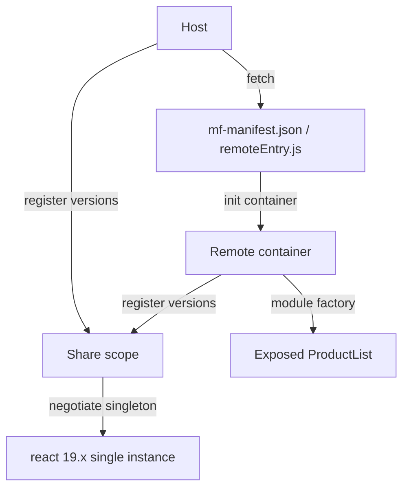

# Module Federation: Runtime Dependency Sharing

## Purpose
Module Federation (MF) lets one build (the host) load modules exposed by another independently deployed build (a remote) at runtime, while negotiating shared dependencies such as React so only one copy loads. This skill produces correct host/remote configuration, shared-scope rules and failure handling for Webpack 5, Rspack and Vite.

## Agent Protocol

### Trigger
"module federation", "remoteEntry.js", "mf-manifest.json", "shared singleton", "requiredVersion", "eager", "Rspack MF", "federated types", "Shared module is not available for eager consumption".

### Input Context
- Bundler (Webpack 5, Rspack/Rsbuild, Vite) and framework.
- Host vs. remote role of each app; SSR or client-only.
- Shared libraries and their version ranges.

### Output Artifact
Bundler config for host and remote(s), bootstrap entry, runtime loading code.

### Response Format
```
Role: {host|remote}  Bundler: {webpack|rspack|vite}
Exposes: {./Name -> path}
Remotes: {name -> manifest URL}
Shared: {lib: singleton, requiredVersion}
Notes: {eager/bootstrap, types, fallback}
```

## How It Works
1. A remote build emits a container (`remoteEntry.js`) and, with the `@module-federation/enhanced` runtime, an `mf-manifest.json` describing exposes and shared deps.
2. The host initialises a **share scope**. Each container registers the versions of shared libs it can provide.
3. On `import('remote/Module')` the runtime loads the container, negotiates shared versions (highest compatible version wins; `singleton: true` forces one instance) and returns the module factory.
4. Shared modules are async by default, which is why the app entry must be asynchronous (bootstrap pattern).

## Packages (current)
| Bundler | Plugin |
|---------|--------|
| Webpack 5 | `@module-federation/enhanced/webpack` (`ModuleFederationPlugin`); the built-in `webpack.container.ModuleFederationPlugin` still works but lacks manifest/runtime plugins |
| Rspack / Rsbuild | `@module-federation/enhanced/rspack` or `@module-federation/rsbuild-plugin` (Rspack also ships a built-in `rspack.container.ModuleFederationPlugin`) |
| Vite | `@module-federation/vite` |

## Remote Config (Rspack / Webpack, same shape)

```js
// rspack.config.mjs (remote "catalog")
import { ModuleFederationPlugin } from '@module-federation/enhanced/rspack';

export default {
  output: { uniqueName: 'catalog', publicPath: 'auto' },
  plugins: [
    new ModuleFederationPlugin({
      name: 'catalog',
      filename: 'remoteEntry.js',
      exposes: {
        './ProductList': './src/ProductList.tsx',
      },
      shared: {
        react: { singleton: true, requiredVersion: '^19.0.0' },
        'react-dom': { singleton: true, requiredVersion: '^19.0.0' },
      },
      dts: true, // generate and publish types for consumers
    }),
  ],
};
```

## Host Config

```js
// rspack.config.mjs (host "shell")
import { ModuleFederationPlugin } from '@module-federation/enhanced/rspack';

export default {
  plugins: [
    new ModuleFederationPlugin({
      name: 'shell',
      remotes: {
        catalog: `catalog@${process.env.CATALOG_MANIFEST_URL}`, // e.g. https://cdn.example.com/catalog/mf-manifest.json
      },
      shared: {
        react: { singleton: true, requiredVersion: '^19.0.0' },
        'react-dom': { singleton: true, requiredVersion: '^19.0.0' },
      },
    }),
  ],
};
```

## Bootstrap Pattern (avoids eager-consumption errors)

```ts
// src/index.ts — entry only defers to bootstrap
import('./bootstrap');
```
```tsx
// src/bootstrap.tsx
import { createRoot } from 'react-dom/client';
import { App } from './App';

const container = document.getElementById('root');
if (!container) throw new Error('Missing #root element');
createRoot(container).render(<App />);
```
Alternative: `eager: true` on a shared lib bundles it into the entry chunk; use only in the host and only when you accept the size cost.

## Dynamic Remotes at Runtime

```ts
import { createInstance } from '@module-federation/enhanced/runtime';

const mf = createInstance({
  name: 'shell',
  remotes: [], // registered later from config service
});

export async function loadRemote<T>(name: string, entry: string, module: string): Promise<T> {
  mf.registerRemotes([{ name, entry }]);
  const mod = await mf.loadRemote<T>(`${name}/${module}`);
  if (!mod) throw new Error(`Remote module ${name}/${module} failed to load from ${entry}`);
  return mod;
}
```
Older runtime versions expose `init()`/`loadRemote()` as module-level functions; check the installed version.

## Shared Config Rules
| Option | Meaning | Guidance |
|--------|---------|----------|
| `singleton: true` | Only one version may load | Required for React, ReactDOM, router, styled-components, any lib with module-level state or context |
| `requiredVersion` | Accepted semver range | Set explicitly; default is read from package.json |
| `strictVersion: true` | Throw instead of warn on mismatch | Use in CI/staging to catch skew early |
| `eager: true` | Include in initial chunk | Avoid in remotes |
| `shareScope` | Named scope | Only for advanced multi-scope setups |

## Failure Modes
| Symptom | Cause | Fix |
|---------|-------|-----|
| "Shared module is not available for eager consumption" | Sync entry imports shared lib | Bootstrap pattern or `eager: true` in host |
| "Invalid hook call" | Two React copies | `singleton: true` on react and react-dom in all builds |
| ChunkLoadError from remote | Wrong `publicPath` | `publicPath: 'auto'` or absolute CDN URL |
| Stale remote after deploy | Cached `remoteEntry.js`/manifest | `Cache-Control: no-cache` on entry/manifest, long cache on hashed chunks |
| Whole page white-screens | Unhandled remote load error | Error boundary + fallback per remote |

## Architecture



## Checklist
- [ ] Every federated app uses an async bootstrap entry.
- [ ] React-family libs are singletons with explicit `requiredVersion` in all builds.
- [ ] Remote URLs come from env/config, not hardcoded.
- [ ] Entry files served with `no-cache`; hashed chunks immutable.
- [ ] Types shared (`dts`) or a contract package exists.
- [ ] Error boundary around every remote import.
- [ ] CI check that fails on shared version mismatch (`strictVersion` in staging).
