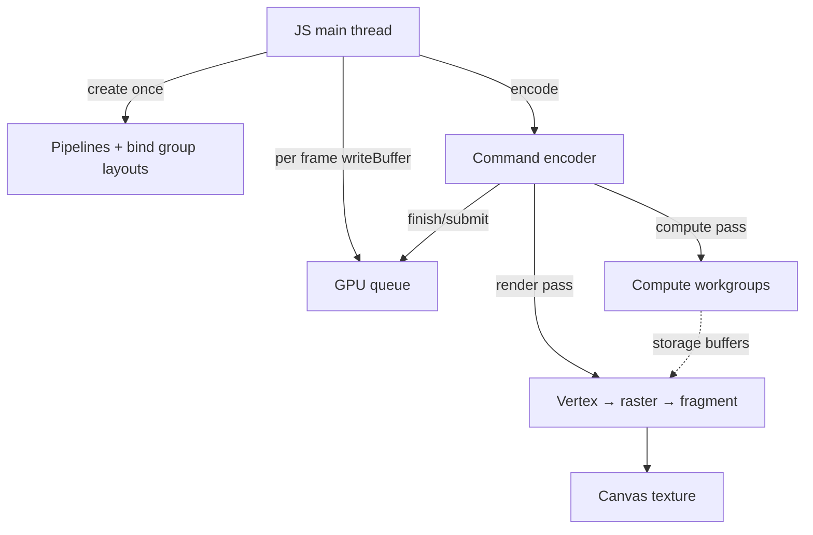

# WebGPU & WebGL: Pipelines and GPU Memory

## Purpose
WebGPU is the modern browser GPU API (modelled on Vulkan/Metal/D3D12) with explicit pipelines, bind groups, command encoders and compute shaders written in WGSL. It ships in Chromium-based browsers (desktop since Chrome 113, Android since 121), Safari 26 and Firefox 141 on Windows, with other platforms rolling out; WebGL2 remains the universal fallback. This skill produces correct setup code, memory layout and frame-loop rules.

## Agent Protocol

### Trigger
"WebGPU", "WGSL", "WebGL2", "GLSL", "bind group", "uniform buffer alignment", "compute shader", "instancing", "draw calls", "GPU device lost".

### Input Context
- Target browsers/devices and whether a WebGL2 fallback is required.
- Workload: rendering, compute (ML, particles, image processing) or both.
- Data sizes and update frequency (static meshes vs. per-frame uniforms).

### Output Artifact
Initialization code, WGSL/GLSL shaders, buffer layout table and frame-loop structure.

### Response Format
```
API: {WebGPU|WebGL2|WebGPU+WebGL2 fallback}
Pipelines: {name -> shader stages, vertex layout}
Bind groups: {group index -> resources, update frequency}
Buffers: {name, usage flags, size, alignment}
Per-frame work: {uploads, passes, dispatches}
```

## Feature Detection and Device Setup

```ts
export async function initWebGPU(canvas: HTMLCanvasElement) {
  if (!('gpu' in navigator)) throw new Error('WebGPU not supported: use WebGL2 fallback');
  const adapter = await navigator.gpu.requestAdapter({ powerPreference: 'high-performance' });
  if (!adapter) throw new Error('No suitable GPU adapter found');
  const device = await adapter.requestDevice();

  device.lost.then((info) => {
    console.error(`WebGPU device lost (${info.reason}): ${info.message}`);
    // Recreate device and all GPU resources unless reason === 'destroyed'
  });

  const context = canvas.getContext('webgpu');
  if (!context) throw new Error('Failed to get webgpu canvas context');
  const format = navigator.gpu.getPreferredCanvasFormat();
  context.configure({ device, format, alphaMode: 'premultiplied' });
  return { device, context, format };
}
```

## Minimal Render Pipeline (WGSL)

```wgsl
struct Uniforms { mvp : mat4x4<f32> };
@group(0) @binding(0) var<uniform> u : Uniforms;

struct VSOut { @builtin(position) pos : vec4<f32>, @location(0) color : vec3<f32> };

@vertex
fn vs(@location(0) position : vec3<f32>, @location(1) color : vec3<f32>) -> VSOut {
  var o : VSOut;
  o.pos = u.mvp * vec4<f32>(position, 1.0);
  o.color = color;
  return o;
}

@fragment
fn fs(in : VSOut) -> @location(0) vec4<f32> {
  return vec4<f32>(in.color, 1.0);
}
```

```ts
const module = device.createShaderModule({ code: shaderSource });
const pipeline = device.createRenderPipeline({
  layout: 'auto',
  vertex: {
    module, entryPoint: 'vs',
    buffers: [{
      arrayStride: 24, // 6 floats: position + color
      attributes: [
        { shaderLocation: 0, offset: 0, format: 'float32x3' },
        { shaderLocation: 1, offset: 12, format: 'float32x3' },
      ],
    }],
  },
  fragment: { module, entryPoint: 'fs', targets: [{ format }] },
  primitive: { topology: 'triangle-list', cullMode: 'back' },
  depthStencil: { format: 'depth24plus', depthWriteEnabled: true, depthCompare: 'less' },
});

const uniformBuffer = device.createBuffer({
  size: 64, // mat4x4<f32>
  usage: GPUBufferUsage.UNIFORM | GPUBufferUsage.COPY_DST,
});
const bindGroup = device.createBindGroup({
  layout: pipeline.getBindGroupLayout(0),
  entries: [{ binding: 0, resource: { buffer: uniformBuffer } }],
});

function frame(mvp: Float32Array, vertexBuffer: GPUBuffer, vertexCount: number, depthView: GPUTextureView) {
  device.queue.writeBuffer(uniformBuffer, 0, mvp);
  const encoder = device.createCommandEncoder();
  const pass = encoder.beginRenderPass({
    colorAttachments: [{
      view: context.getCurrentTexture().createView(),
      clearValue: { r: 0, g: 0, b: 0, a: 1 }, loadOp: 'clear', storeOp: 'store',
    }],
    depthStencilAttachment: { view: depthView, depthClearValue: 1, depthLoadOp: 'clear', depthStoreOp: 'store' },
  });
  pass.setPipeline(pipeline);
  pass.setBindGroup(0, bindGroup);
  pass.setVertexBuffer(0, vertexBuffer);
  pass.draw(vertexCount);
  pass.end();
  device.queue.submit([encoder.finish()]);
  requestAnimationFrame(() => frame(mvp, vertexBuffer, vertexCount, depthView));
}
```
Create pipelines and bind groups once at load; only write buffers and encode passes per frame. Prefer `createRenderPipelineAsync` for large shaders to avoid main-thread stalls.

## Memory Layout Rules (WGSL)
| Type | Size | Alignment |
|------|------|-----------|
| `f32`, `i32`, `u32` | 4 | 4 |
| `vec2<f32>` | 8 | 8 |
| `vec3<f32>` | 12 | **16** |
| `vec4<f32>` | 16 | 16 |
| `mat4x4<f32>` | 64 | 16 |
| struct in uniform buffer | rounded up to its largest member alignment | members in `uniform` arrays need 16-byte stride |

- Dynamic uniform buffer offsets must be multiples of `minUniformBufferOffsetAlignment` (commonly 256): read it from `adapter.limits`/`device.limits`.
- Pack a `vec3` + `f32` together to avoid padding waste.
- Verify layouts with a tool such as `webgpu-utils` (`makeShaderDataDefinitions`) instead of hand-computing offsets.

## Bind Group Frequency
Organise by update rate so fewer bindings change per draw:
- `@group(0)`: per-frame (camera, time)
- `@group(1)`: per-material (textures, samplers)
- `@group(2)`: per-object (model matrix) — or use one storage buffer + instance index instead.

## Upload Strategy
| Data | Method |
|------|--------|
| Small per-frame uniforms | `queue.writeBuffer` |
| Large static meshes | `createBuffer({ mappedAtCreation: true })`, fill, `unmap()` |
| Images | `queue.copyExternalImageToTexture` from `ImageBitmap` (decode off-thread with `createImageBitmap`) |
| GPU → CPU readback | Copy to a `MAP_READ` buffer, `await buffer.mapAsync(GPUMapMode.READ)`; never every frame |

## Compute Example

```wgsl
@group(0) @binding(0) var<storage, read_write> data : array<f32>;
@compute @workgroup_size(64)
fn main(@builtin(global_invocation_id) id : vec3<u32>) {
  if (id.x >= arrayLength(&data)) { return; }
  data[id.x] = data[id.x] * 2.0;
}
```
```ts
pass.dispatchWorkgroups(Math.ceil(elementCount / 64));
```

## WebGL2 Fallback Notes
- Use VAOs, UBOs (`std140` layout), instanced draws (`drawArraysInstanced`), and `texStorage2D`.
- Batch state changes; every `useProgram`/`bindTexture` has driver cost.
- Handle `webglcontextlost`/`webglcontextrestored` by recreating resources.
- Libraries (Three.js, Babylon.js) abstract both backends; prefer them unless you need custom pipelines.

## Performance Rules
- Minimise draw calls: instancing, merged geometry, indirect draws (`drawIndirect`) for GPU-driven culling.
- Never create buffers, textures, pipelines or bind groups inside the frame loop.
- Use `device.pushErrorScope('validation')`/`popErrorScope()` around setup in development.
- Measure with `timestamp-query` feature (when available) and browser GPU profilers, not FPS alone.
- Respect `devicePixelRatio` but cap it (e.g. 2) on high-DPI mobile to bound fill-rate cost.

## Architecture



## Anti-patterns
| Anti-pattern | Fix |
|--------------|-----|
| Creating bind groups per draw per frame | Cache by resource set |
| `vec3` arrays in uniform buffers without padding | Use `vec4` or explicit padding |
| Synchronous readback every frame | Async `mapAsync`, ring of staging buffers |
| Ignoring `device.lost` | Recreate device and resources |
| Assuming WebGPU everywhere | Feature-detect, ship WebGL2 path |

## Checklist
- [ ] Feature detection + fallback path decided.
- [ ] Device-lost and validation error handling present.
- [ ] Buffer layouts verified against WGSL alignment rules.
- [ ] No resource creation in the frame loop.
- [ ] Draw calls batched/instanced; GPU timings measured.
