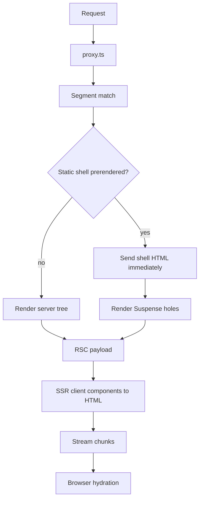

# Next.js Internals: Rendering, Streaming and Caching

## Purpose
Explain the App Router request lifecycle precisely enough to debug it: how a route is classified static or dynamic, what the RSC payload is, how streaming and Partial Prerendering (PPR) work, and which cache layer holds which data. Facts target Next.js 16 (Cache Components, `proxy.ts`, Turbopack default) with notes where Next.js 15 differs.

## Agent Protocol

### Trigger
"RSC payload", "why is this route dynamic", "partial prerendering", "cacheComponents", "use cache", "cacheLife", "cacheTag", "router cache", "stale data after mutation", "streaming SSR".

### Input Context
- Next.js major version and whether `cacheComponents` is enabled in `next.config.ts`.
- `next build` route output and the route's code (data access, `cookies()`, `headers()`, `searchParams`).
- Deployment target (Node server, Vercel, static export, self-hosted with multiple instances).

### Output Artifact
Diagnosis of the route's rendering mode plus the minimal code/config change.

### Response Format
```
Route: {path}  Mode: {static|dynamic|partially prerendered}
Cause: {API or fetch that made it dynamic}
Cache layers involved: {use cache|fetch cache|router cache|CDN}
Fix: {code change}
Invalidation: {revalidateTag|updateTag|revalidatePath|refresh}
```

## Request Lifecycle
1. `proxy.ts` (formerly `middleware.ts`, renamed in Next.js 16) runs first: rewrites, redirects, header/cookie checks. Keep it light; it is not for full auth logic or data fetching.
2. Router matches the segment tree (`layout` → `template` → `page`, plus `loading`, `error`, `not-found`).
3. Server Components render to the **RSC payload**: a streamed serialization of the server tree with placeholders and module references for Client Components and their serialized props.
4. On a full page load the payload + Client Components are SSR'd to HTML; the payload is also inlined so React can hydrate without refetching.
5. On client navigation only the RSC payload for changed segments is fetched; shared layouts are preserved and not re-rendered.

## Static vs Dynamic
A route is prerendered at build time unless something request-specific is used during render:
- Request APIs: `cookies()`, `headers()`, `draftMode()`, reading `searchParams`, `connection()`.
- Uncached data access (in Next.js 15+, `fetch` is **not** cached by default).
- `export const dynamic = 'force-dynamic'` (route segment config; not compatible with Cache Components mode).

In Next.js 15+, `params`, `searchParams`, `cookies()` and `headers()` are **async** and must be awaited.

## Cache Components (Next.js 16, opt-in)

```ts
// next.config.ts
import type { NextConfig } from 'next';
const nextConfig: NextConfig = { cacheComponents: true };
export default nextConfig;
```
With it enabled, everything is dynamic by default and you opt into caching with the `'use cache'` directive. The static shell is prerendered, and dynamic parts must sit inside `<Suspense>` so they stream in (this is Partial Prerendering, now the default model; the old `experimental.ppr` flag is removed).

```tsx
// app/products/[id]/page.tsx
import { Suspense } from 'react';
import { cacheLife, cacheTag } from 'next/cache';
import { cookies } from 'next/headers';

async function getProduct(id: string) {
  'use cache';
  cacheLife('hours');
  cacheTag(`product:${id}`);
  return db.product.findUniqueOrThrow({ where: { id } });
}

export default async function Page({ params }: { params: Promise<{ id: string }> }) {
  const { id } = await params;
  const product = await getProduct(id);
  return (
    <main>
      <h1>{product.name}</h1>
      <Suspense fallback={<p>Loading your price…</p>}>
        <PersonalPrice productId={id} />
      </Suspense>
    </main>
  );
}

async function PersonalPrice({ productId }: { productId: string }) {
  const tier = (await cookies()).get('tier')?.value ?? 'standard';
  return <p>{await priceFor(productId, tier)}</p>;
}
```
Cached functions cannot read `cookies()`/`headers()` directly; read them outside and pass values as arguments (arguments become part of the cache key).

## Invalidation (Server Functions / Route Handlers)
| API | Semantics | Use for |
|-----|-----------|---------|
| `updateTag(tag)` | Expire and read fresh data in the same request (read-your-writes); Server Functions only | User just edited their own data |
| `revalidateTag(tag, profile)` | Stale-while-revalidate; Next.js 16 expects a `cacheLife` profile as 2nd arg (e.g. `'max'`) | Background content updates, webhooks |
| `revalidatePath(path)` | Invalidate everything rendered for a path | Coarse invalidation |
| `refresh()` | Refresh uncached data on the client router from a Server Function | Counters, notifications |
| `router.refresh()` | Client-side refetch of current route payload | After non-Next mutations |

## Cache Layers
| Layer | Where | Holds | Cleared by |
|-------|-------|-------|-----------|
| `'use cache'` / data cache | Server (in-memory or custom cache handler) | Function results / fetch responses | tags, `cacheLife` expiry |
| Full route / static shell | Build output + server/CDN | Prerendered HTML + payload | revalidation, redeploy |
| Client router cache | Browser memory | Visited segment payloads | navigation rules, `router.refresh()`, Server Function invalidation |
| CDN | Edge | HTTP responses | `Cache-Control`, purge |

Self-hosting with multiple instances needs a shared cache handler (configured via `cacheHandlers`/`cacheHandler` in `next.config`), otherwise each instance has its own cache and tag invalidation does not propagate.

## Streaming
- `loading.tsx` = automatic `<Suspense>` boundary around the page segment.
- Granular `<Suspense>` around slow components flushes the shell first; HTML chunks for resolved boundaries arrive later in the same response.
- Status code and headers are sent with the first byte; a `notFound()` thrown after streaming started cannot change the 200 status (Next renders the not-found UI and adds `noindex`). Resolve existence checks before the first Suspense boundary.

## Diagnosing
- `next build` prints each route's mode (static, partial prerender, dynamic).
- Under Cache Components, accessing uncached/request data outside Suspense raises a build error naming the component: wrap it in Suspense or cache it.
- Set `logging.fetches.fullUrl: true` in `next.config` to log fetch cache hits/misses in dev.

## Architecture



## Anti-patterns
| Anti-pattern | Fix |
|--------------|-----|
| Calling `cookies()` in root layout | Read it in the leaf that needs it, inside Suspense |
| Expecting `fetch` to be cached (Next 13/14 habit) | Explicit `'use cache'` or `cache: 'force-cache'` |
| Auth enforced only in `proxy.ts` | Check authorization in data access and Server Functions too |
| Per-instance cache on multi-node deploy | Shared cache handler (Redis etc.) |
| Synchronous `params.id` | `const { id } = await params` |

## Checklist
- [ ] Route modes in `next build` output match intent.
- [ ] Request APIs only inside Suspense-wrapped leaves.
- [ ] Every cached function has `cacheLife` and tags for invalidation.
- [ ] Mutations call `updateTag`/`revalidateTag` with correct tags.
- [ ] Multi-instance hosting uses a shared cache handler.
