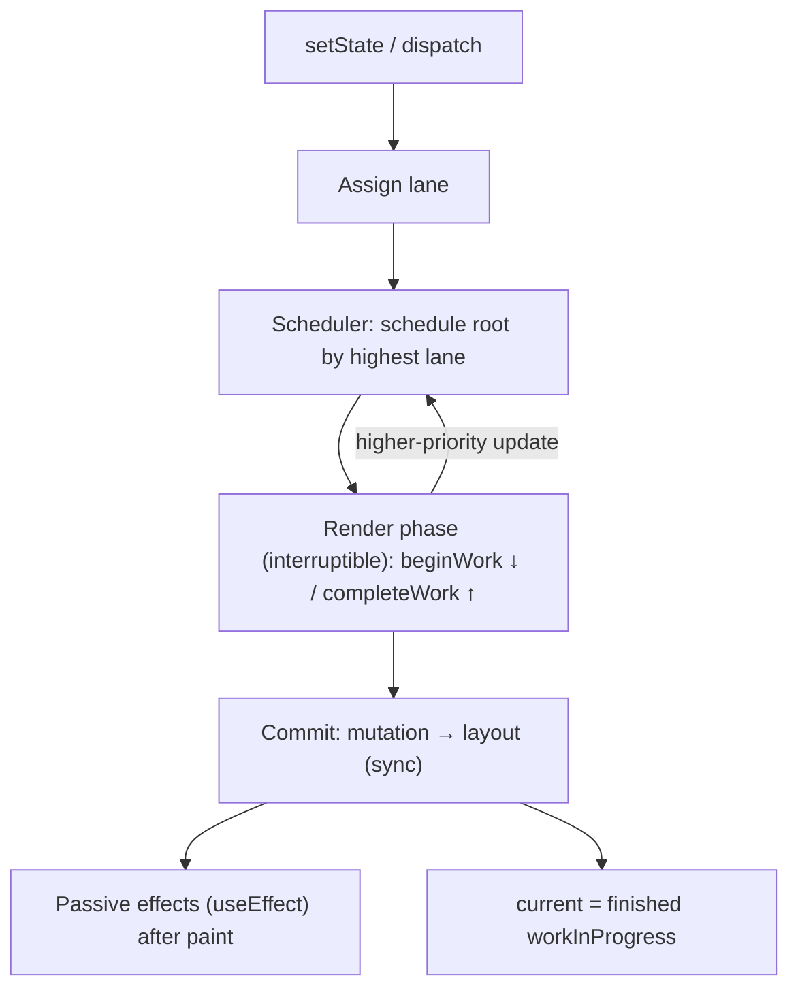

# React Fiber Architecture

## Purpose
Fiber is React's reconciler (since React 16): a linked tree of work units that lets React split rendering into interruptible chunks, prioritise updates with lanes, and commit changes atomically. Knowing the model explains concurrent features (`useTransition`, `useDeferredValue`, Suspense), double renders in Strict Mode, and why render functions must be pure.

## Agent Protocol

### Trigger
"fiber", "reconciliation", "reconciler", "render phase", "commit phase", "lanes", "time slicing", "concurrent rendering", "scheduler", "double render", "tearing".

### Input Context
- React version (18/19) and root API (`createRoot` enables concurrent features).
- Observed behaviour (extra renders, janky input, stale UI, effect order).
- Profiler output if available (React DevTools Profiler, Performance panel tracks).

### Output Artifact
Explanation of the behaviour in Fiber terms + concrete code change.

### Response Format
```
Symptom: {what was observed}
Phase: {render|commit|passive effects}
Priority/lane: {sync|input|transition|idle}
Cause: {e.g. impure render, unstable key, sync update blocking}
Fix: {code change}
```

## Fiber Node (simplified, React 18/19 source)
```ts
type Fiber = {
  tag: WorkTag;              // FunctionComponent, HostComponent, SuspenseComponent, ...
  key: string | null;
  type: any;                 // component function or host tag ('div')
  stateNode: any;            // DOM node for host fibers
  return: Fiber | null;      // parent
  child: Fiber | null;       // first child
  sibling: Fiber | null;     // next sibling
  index: number;
  pendingProps: any;
  memoizedProps: any;
  memoizedState: any;        // hooks linked list for function components
  updateQueue: unknown;
  lanes: Lanes;              // pending work on this fiber
  childLanes: Lanes;         // pending work in subtree
  flags: Flags;              // Placement, Update, ChildDeletion, Passive, ...
  subtreeFlags: Flags;       // aggregated flags of descendants
  deletions: Fiber[] | null;
  alternate: Fiber | null;   // the other tree's version of this fiber
};
```
Older articles describe an "effect list" (`effectTag`, `nextEffect`, `firstEffect`); React 18 replaced it with `flags` + `subtreeFlags`, letting commit skip subtrees with no work.

## Double Buffering
- `current` tree = what is on screen. `workInProgress` tree = being built.
- Each fiber points to its counterpart via `alternate`; React reuses those objects between renders.
- On commit, the root's `current` pointer swaps to the finished work-in-progress tree in one step, so users never see a half-updated UI.

## Phases

| Phase | Interruptible | What happens | Your code that runs |
|-------|---------------|--------------|---------------------|
| Render | Yes (in concurrent renders) | `beginWork` walks down calling components and diffing children; `completeWork` walks up creating/preparing host nodes and bubbling flags | Component bodies, `useState` initializers, `useMemo`, reducers |
| Commit — mutation | No | Apply DOM insertions/updates/deletions; detach refs | ref cleanup, `useInsertionEffect` |
| Commit — layout | No | Attach refs, run layout effects synchronously before paint | `useLayoutEffect`, ref callbacks |
| Passive effects | Scheduled after paint (flushed synchronously if a sync update follows) | Run effect cleanups then setups | `useEffect` |

Because render can run multiple times or be thrown away, render code must be pure. Strict Mode (development) intentionally double-invokes component bodies, initializers and effect setup/cleanup to surface impurity.

## Reconciliation Rules
- Elements of different `type` at the same position → old subtree unmounted, new mounted (state lost).
- Same type → props updated, fiber reused, state kept.
- Lists are matched by `key`; index keys break state when items reorder/insert. Use stable IDs.
- Changing a `key` deliberately resets a component's state.

## Lanes and Scheduling
React assigns each update a lane (bitmask priority):
- **SyncLane**: discrete events (click, keydown) and `flushSync`.
- **InputContinuousLane**: continuous events (scroll, pointermove).
- **DefaultLane**: updates outside events (e.g. after `fetch`).
- **TransitionLanes**: updates inside `startTransition`/`useTransition`, `useDeferredValue`.
- **IdleLane / OffscreenLane**: lowest priority, hidden content (`<Activity mode="hidden">` in React 19.2).

The `scheduler` package runs concurrent work in roughly 5 ms slices and yields via `MessageChannel` (falling back to `setTimeout`), not `requestIdleCallback`. Higher-priority lanes interrupt transition renders; the interrupted work is restarted. All updates are batched automatically (React 18+), including inside promises and timeouts.

```tsx
import { useState, useTransition } from 'react';

function Search({ items }: { items: string[] }) {
  const [query, setQuery] = useState('');
  const [filter, setFilter] = useState('');
  const [isPending, startTransition] = useTransition();

  return (
    <>
      <input
        value={query}
        onChange={(e) => {
          setQuery(e.target.value);                         // SyncLane: input stays responsive
          startTransition(() => setFilter(e.target.value)); // TransitionLane: interruptible
        }}
      />
      {isPending && <span aria-live="polite">Updating…</span>}
      <List items={items} filter={filter} />
    </>
  );
}
```
Transitions only help when the expensive part is **rendering** (many components). A single long synchronous computation still blocks; move it to a Web Worker or memoize.

## Suspense in Fiber Terms
When a component suspends (throws/uses an unresolved promise via `use`), React marks the nearest Suspense boundary, shows its fallback (or, during a transition, keeps old UI visible), and retries the subtree when the promise resolves.

## Bailouts
React skips re-rendering a fiber when props are referentially equal, no state/context changed and no pending lanes exist on it — `React.memo`, stable props and the React Compiler (1.0, auto-memoization) maximise bailouts.

## Architecture



## Anti-patterns
| Anti-pattern | Fix |
|--------------|-----|
| Side effects in render (fetch, subscriptions, mutations) | Move into effects or event handlers |
| Index as key in reorderable lists | Stable IDs |
| Wrapping a CPU-bound function in `startTransition` expecting no jank | Web Worker / chunking |
| `useLayoutEffect` for non-layout work | `useEffect` |
| Defining components inside components | Hoist to module scope (new type each render remounts) |

## Checklist
- [ ] Render functions are pure and idempotent (passes Strict Mode).
- [ ] Keys are stable and unique.
- [ ] Urgent vs. non-urgent updates separated with transitions where render cost is high.
- [ ] Profiler confirms where time is spent before optimising.
