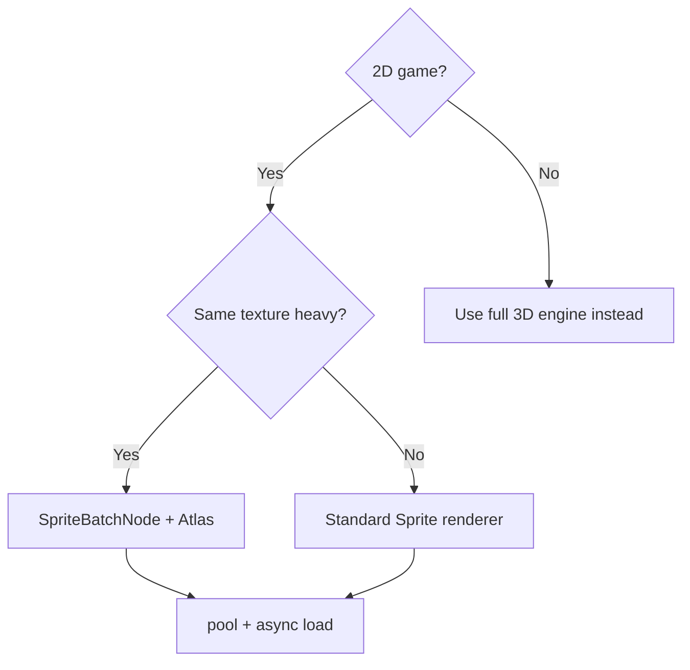

# Cocos2d-x Architectural Patterns

## Purpose
Cocos2d-x has a mature scene-graph architecture centered on the `Director` and `Node` tree. Understanding its internals lets you design for performance: batched rendering, minimal state changes, and memory discipline on mobile.

## Agent Protocol

### Trigger
"cocos2d-x internals", "cocos director", "cocos scene graph", "cocos render queue", "cocos memory management".

### Input Context
- Cocos2d-x version and language (C++, Lua, JS bindings)
- Platform targets
- Observed performance or memory problem

### Output Artifact
Architecture guidance and C++ code. No file unless requested.

### Response Format
```
Area: {director | scene graph | renderer | events | memory}
Finding: {cause}
Fix: {code}
Verify: {draw-call / memory measurement}
```

## 1. The Director Lifecycle

Status note: Cocos2d-x's last major release is 4.0 (2019) and it is no longer actively developed; Cocos Creator 3.x (whose native runtime evolved from Cocos2d-x) is the maintained product. Use this skill for existing Cocos2d-x codebases.

The `Director` singleton drives the game.

```
Director::mainLoop()
  -> calculateDeltaTime()
  -> update()         // scheduled updates + physics step (if enabled)
  -> drawScene()      // render current scene
```

- `Director::runWithScene()` sets the initial scene.
- `Director::replaceScene()` swaps current scene (with optional transition).
- `Director::pushScene()/popScene()` for pause menus layered over gameplay.

### 1.1 Frame pacing

- `Director::setAnimationInterval(1.0/60.0)` sets the desired FPS.
- On mobile, respect `setProjection`/retina scaling (`CC_CONTENT_SCALE_FACTOR`).

## 2. Scene Graph & Node Tree

- `Node` is the base: position, rotation, scale, skew, opacity, anchor point, children, z-order.
- Transform hierarchy: local transforms multiplied up the chain → world MVP.
- `addChild(node, zOrder)`.
- Depth-first traversal via `visit()`.

### 2.1 Transforms & Anchor Points

- `setAnchorPoint()` sets the pivot in normalised content-size units: plain `Node` defaults to (0,0), `Sprite` to (0.5,0.5); the origin is bottom-left, y up.
- 2D games: work with `Vec2`/`Size`; world coordinates via `convertToWorldSpaceAR`.
- Be careful with parent scale/rotation affecting child positions — standard matrix chaining.

### 2.2 Event System

- `EventListenerTouchOneByOne` / `EventListenerTouchAllAtOnce`.
- Custom events: `EventDispatcher::dispatchCustomEvent("name", &data)`.
- Register with `_eventDispatcher->addEventListenerWithSceneGraphPriority(listener, node)`: priority follows draw order and the listener is removed with the node. Fixed-priority listeners must be removed manually.

## 3. Rendering Architecture: The Render Queue

Draw calls are NOT issued during traversal. `Node::visit()` pushes `RenderCommand`s into a `Renderer` queue:

```
visit() -> pushCommand(RenderCommand)  for each node
Renderer::render() -> sort commands (by z-order; transparent after opaque)
                   -> group by texture/shader to batch draw calls
                   -> flush GPU commands
```

### 3.1 Batching Strategy

- Since v3 the `Renderer` auto-batches consecutive `TrianglesCommand`s with the same texture, shader (GLProgramState) and blend func, so `SpriteBatchNode` is rarely needed.
- Atlases (`SpriteFrameCache` + TexturePacker plists) keep consecutive sprites on one texture.
- Sorting: opaque up-front (no blending), transparent sorted back-to-front.

### 3.2 Reducing Draw Calls (mobile gold)

1. Pack art into atlases → fewer texture switches.
2. Keep draw order grouped by atlas (children of one parent from one atlas).
3. Avoid per-sprite custom shaders/uniforms — each unique GLProgramState breaks the batch.
4. Avoid per-node opacity/rotation trick for static UI; group static UI into one node.
5. Disable depth test for 2D when not needed.

### 3.3 Custom Rendering

- Subclass `Node` and override `draw(Renderer* renderer, const Mat4& transform, uint32_t flags)` to push a `TrianglesCommand` or `CustomCommand`.
- `Renderer` supports custom geometry (a quad list) — great for particle trails, vector UI.

## 4. Action System (Animation Without Code)

- `Action`s: `MoveTo`, `Sequence`, `Spawn`, `RepeatForever`, `EaseIn`.
- `node->runAction(...)`; the `ActionManager` (a scheduled update on the main thread) steps all actions each frame.
- Hierarchy: `Sequence`/`Spawn` composite actions; `ActionInterval` for timed.
- `Director::getScheduler()` controls update priorities of actions.

### 4.1 Scheduler

- `scheduler->schedule(...)` with time intervals; `update(dt)` for every frame.
- `scheduleUpdate()` / `unscheduleUpdate()` on nodes.
- Pause/Resume: scheduler respects `Director::pause()`.

## 5. Physics in Cocos2d-x

- 2D: the integrated `PhysicsWorld`/`PhysicsBody` API wraps Chipmunk2D (`CC_USE_CHIPMUNK`); Box2D is available for direct use.
- 3D: `Physics3DWorld` wraps Bullet (`CC_USE_3D_PHYSICS`).
- `PhysicsBody::createBox`, `PhysicsWorld` integrated to scene.
- Fixed timestep via scheduler; collisions: `EventListenerPhysicsContact`.

### 5.1 Sensor pattern

Mark the shape as a sensor (`PhysicsShape::setSensor(true)`), set contact-test bitmasks, and handle `EventListenerPhysicsContact::onContactBegin` (return `false` to skip collision response).

## 6. Memory & Resource Management

- `Ref`/`RefCounted`-style retention: `retain()/release()` (Cocos uses its own `Ref`).
- `Director::getInstance()->getTextureCache()->addImage()` caches textures (avoid duplicate loads).
- `SpriteFrameCache::getInstance()->addSpriteFramesWithFile()` for atlases.
- Objects are autoreleased by `create()`; `addChild` retains them — only call `retain()` for objects you hold outside the scene graph.
- **Rule**: keep references to big assets; `removeUnusedTextures()` after scene transitions.

### 6.1 Pooling Pattern

```cpp
// Cocos2d-x has no built-in pool; cocos2d::Vector retains its elements.
class BulletPool {
public:
    Sprite* acquire() {
        if (_free.empty()) return Sprite::createWithSpriteFrameName("bullet.png");
        Sprite* b = _free.back();        // still retained by _free
        b->retain();
        _free.popBack();
        b->autorelease();                // balance the extra retain
        return b;
    }
    void release(Sprite* b) {
        _free.pushBack(b);               // retain before detaching
        b->removeFromParentAndCleanup(true);
    }
private:
    Vector<Sprite*> _free;
};
```

## 7. Cross-Platform Build Pattern

- Engine wraps platform code (`platform/`): iOS/Win32/Android/Mac/Linux; define `__APPLE__`, `CC_PLATFORM_*` macros.
- Resource paths: use `FileUtils::getInstance()->fullPathForFilename()`; Assets folder mapped per-platform.
- Audio: `AudioEngine::play2d`; OGG/MP3/WAV platform-specific loading via `AudioDecoder`.
- Bundled assets live in `Resources/` (copied to the APK `assets/` on Android); add search paths with `FileUtils::addSearchPath()`.

### 7.1 Cocos Creator 3.x vs Cocos2d-x

| | Cocos2d-x (C++) | Cocos Creator (TS/editor) |
|--|------------------|---------------------------|
| Language | C++ | TypeScript |
| Rendering | OpenGL ES/Metal | Vulkan/GL/Metal (multibackend) |
| Editor | none (code-first) | full editor + scene system |
| Use case | perf-critical, engine-level | team-based game dev |

## 8. Common Anti-Patterns

| Anti-pattern | Consequence | Fix |
|--------------|-------------|-----|
| One texture per sprite | Draw call explosion | atlas + batch node |
| per-node `retain()` leaks | memory growth | pooled/refcache |
| Actions recreated each frame | alloc churn | reuse cached actions |
| Global `Director` misuse in logic | scene-restart bugs | keep in scene node |
| blocking file loads | UI stalls | async load + cache |

## 9. Decision Tree



## 10. References

- `skills/game/cocos2d/SKILL.md` — full Cocos2d game dev guide
- Cocos2d-x docs on Renderer, Director, Node, Actions, Physics