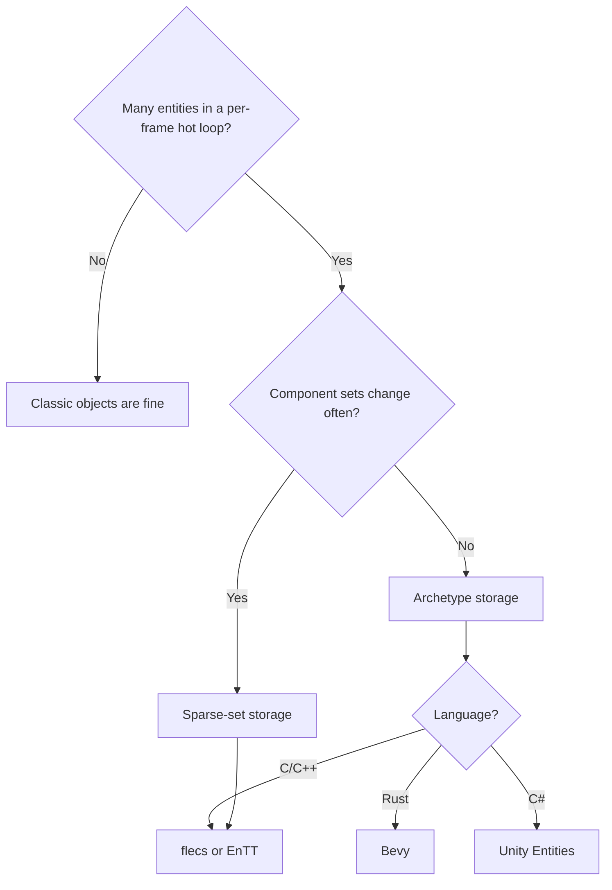

# ECS Architecture — Supplementary Notes

Folded in from the former `game/ecs-architecture` skill. Storage models, scheduling, command buffers, anti-patterns and engine notes are covered in `../SKILL.md`; this file keeps the material that is not repeated there.

## 1. Querying and Matching
- Archetype storage: each archetype has a component-signature bitmask; a query matches archetypes whose mask contains the required bits and none of the excluded ones, then iterates their columns. Cache the matched-archetype list per query and update it when a new archetype appears.
- Sparse-set storage: iterate the smallest dense array among the required components and test membership in the others (`storage.contains(entity)`). EnTT "groups" pre-sort several pools so a multi-component query becomes a linear walk.
- Optional components (`Option<&T>` in Bevy, `try_get` in EnTT) need a per-entity presence check; keep them out of the hottest loops.

## 2. Change Detection
- Keep a change version per component column (archetype/chunk) or per row, bumped on write access.
- Dirty-driven systems (network send, bounds recompute, render-node sync) then process only changed entities.
- Bevy: `Added<T>` and `Changed<T>` query filters. Unity Entities: per-chunk change versions via `.WithChangeFilter<T>()` on `SystemAPI.Query` or `[WithChangeFilter(typeof(T))]` on an `IJobEntity`. Chunk-level filters report a whole chunk as changed when any write access happened, so treat them as a coarse filter.

## 3. Events and Messages
- Model transient events (collisions, input) as per-frame event queues or short-lived event entities that a system consumes and clears.
- Avoid spawning and destroying thousands of event entities per frame; that is structural churn. Bevy's event/message queues and flecs observers avoid it.

## 4. Serialization, Networking and Replays
- Serialize by entity id plus its component list; remap ids on load because indices differ between sessions.
- Networking: replicate only changed components (using change detection) and quantize floats before sending.
- Replays: record inputs per tick; a deterministic simulation reproduces the session from them.

## 5. Library Comparison

| Library / engine | Storage | Notes |
|--------|---------|-----------|
| Unity Entities (DOTS) | Archetype chunks | Burst + Jobs, editor tooling, baking from GameObjects |
| Bevy | Archetype tables, optional sparse-set components (Rust) | Automatic parallel scheduling from declared access, ergonomic queries |
| EnTT | Sparse sets with optional groups (C++17, header-only) | Very cheap add/remove; optional `entt::meta` reflection module |
| flecs | Archetype tables (C99 core, C++ API) | Entity relationships (`ChildOf`, custom pairs), prefabs, observers, query language |

## 6. Choosing Storage by Language and Churn

## 7. Getting Started Checklist
1. Model components as small structs; split hot and cold data.
2. Choose storage (sparse sets for churn, archetypes for bulk iteration).
3. Define systems with explicit read/write sets and build the dependency graph.
4. Route structural changes through a command buffer applied at sync points.
5. Add change detection for dirty-driven systems.
6. Measure iteration throughput, cache misses and parallel speed-up on the target hardware.
