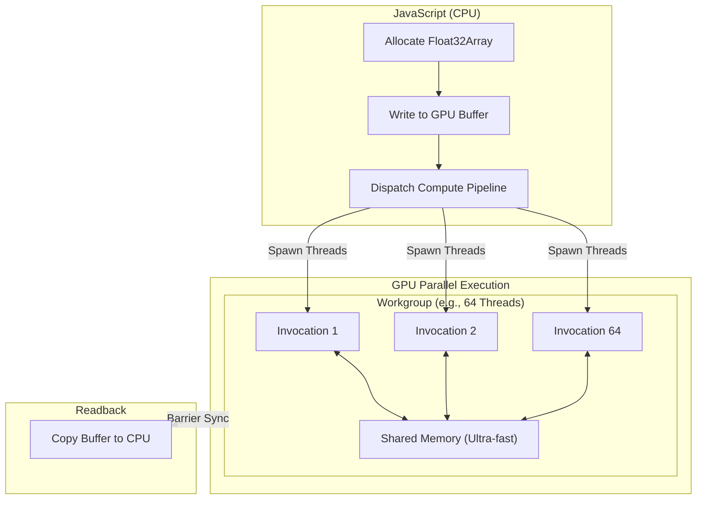

# WebGPU & Compute Shaders

## Purpose
Explain general-purpose GPU compute in the browser via WebGPU: authoring WGSL compute shaders, dispatching workgroups, and using shared/workgroup memory and storage buffers efficiently.

## Agent Protocol

### Trigger
User phrases: "WebGPU compute", "WGSL compute shader", "workgroup size", "storage buffer binding", "GPGPU in browser".

### Input Context
- Problem to parallelize and data sizes.
- Target workgroup dimensions.

### Output Artifact
Compute pipeline + WGSL shader design.

### Response Format
```
Kernel: {operation}
Workgroup: {@workgroup_size(x,y,z)}
Buffers: {storage / uniform bindings}
```


## Core Mechanics

WebGPU is the modern successor to WebGL. It unlocks the massive parallel processing power of the GPU directly in the browser, not just for drawing triangles, but for general-purpose compute (GPGPU) like Physics simulations or Machine Learning.

### 1. Compute Shaders (WGSL)
Unlike Vertex or Fragment shaders which are tied to the rendering pipeline, a Compute Shader is just a program executed thousands of times simultaneously by the GPU. Written in WebGPU Shading Language (WGSL).

### 2. Workgroups & Shared Memory
GPU threads are organized into Workgroups. Threads within the same Workgroup can share a special, ultra-fast memory space (`var<workgroup>`) and synchronize with each other using barriers (`workgroupBarrier()`). This is critical for complex algorithms like Matrix Multiplication.

### Compute Shader Architecture Map


