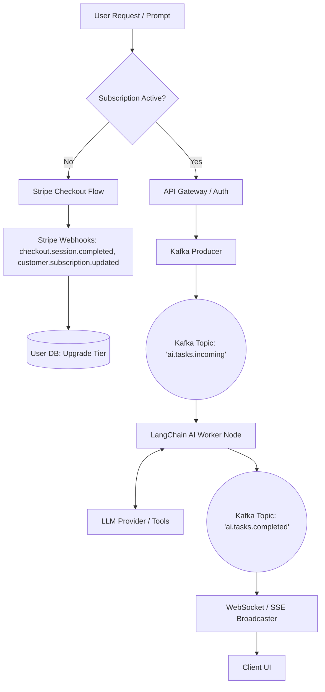

## Purpose
Reference architecture for a full-stack AI SaaS platform: LLM orchestration (LangChain/LlamaIndex) with guardrails, event-driven processing (Kafka), billing (Stripe), and multi-tenant isolation.

## Agent Protocol

### Trigger
User phrases: "AI SaaS playbook", "build an AI SaaS", "LangChain + Kafka + Stripe architecture", "agentic SaaS stack".

### Input Context
- Product requirements, scale targets, and existing stack.
- Constraints (budget, compliance, team size).

### Output Artifact
Architecture guidance and component choices (no files unless requested).

### Response Format
```
Layer: {intelligence | eventing | billing}
Choice: {component + why}
Risk: {cost, tenancy, failure mode}
```


# AI SaaS Master Playbook

**DIRECTIVE**: Execute with absolute precision. Architecture must be robust, scalable, and fault-tolerant. 

## 1. Domain Convergence
- **Intelligence**: LangChain/LlamaIndex for deterministic agentic reasoning and tool execution.
- **Resilience**: Apache Kafka for strictly decoupled, high-throughput, event-driven processing.
- **Monetization**: Stripe for aggressive subscription gating and usage-based billing.

## 2. System Architecture



## 3. Core Orchestration Logic

```python
import json
import logging
import os
import uuid

from fastapi import Depends, FastAPI, HTTPException
from kafka import KafkaProducer
from pydantic import BaseModel, Field

from app.auth import current_user          # verifies the session/JWT server-side
from app.billing import get_entitlement    # local table synced from verified Stripe webhooks

log = logging.getLogger(__name__)
app = FastAPI()
producer = KafkaProducer(
    bootstrap_servers=os.environ["KAFKA_BOOTSTRAP_SERVERS"],
    value_serializer=lambda v: json.dumps(v).encode("utf-8"),
    acks="all",
)

class AgentRequest(BaseModel):
    prompt: str = Field(min_length=1, max_length=8000)

@app.post("/api/v1/execute-agent", status_code=202)
def execute_agentic_workflow(body: AgentRequest, user=Depends(current_user)):
    # 1. Monetization gate: read the entitlement your webhooks maintain; never trust a user_id from the body
    entitlement = get_entitlement(user.id)
    if entitlement is None or entitlement.status not in ("active", "trialing"):
        raise HTTPException(status_code=402, detail="Payment required. Please upgrade your tier.")

    # 2. Event-driven handoff, keyed by tenant for per-tenant ordering
    task_id = str(uuid.uuid4())
    producer.send("ai.tasks.incoming", key=user.tenant_id.encode(), value={
        "task_id": task_id, "user_id": user.id, "tenant_id": user.tenant_id, "prompt": body.prompt,
    })
    log.info("queued agent task task_id=%s tenant_id=%s", task_id, user.tenant_id)
    return {"task_id": task_id, "status": "QUEUED"}

# ---------------------------------------------------------
# Background Kafka Consumer & LangChain Worker (Conceptual)
# ---------------------------------------------------------
# LangChain 1.x: build agents with langchain.agents.create_agent (or LangGraph);
# initialize_agent / "zero-shot-react-description" are legacy and removed.
# def consume_and_process():
#     agent = create_agent(model=llm, tools=tools)          # bounded tools, per-tenant limits
#     for msg in consumer:                                    # KafkaConsumer("ai.tasks.incoming", group_id=...)
#         state = agent.invoke({"messages": [{"role": "user", "content": msg.value["prompt"]}]},
#                              config={"recursion_limit": 25})
#         producer.send("ai.tasks.completed", value={"task_id": msg.value["task_id"], "result": state["messages"][-1].content})
```
