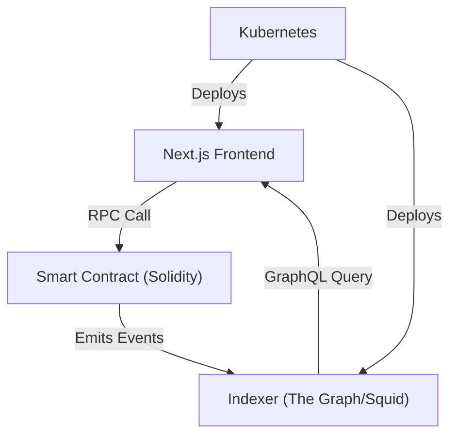

## Purpose
Reference architecture for a full-stack Web3 dApp: Next.js frontend with wallet integration, Solidity contracts, indexing, and Kubernetes deployment.

## Agent Protocol

### Trigger
User phrases: "web3 dapp playbook", "build a full-stack dapp", "Next.js + Solidity architecture", "dapp scaffold".

### Input Context
- Product requirements, scale targets, and existing stack.
- Constraints (budget, compliance, team size).

### Output Artifact
Architecture guidance and component choices (no files unless requested).

### Response Format
```
Layer: {contracts | frontend | infra}
Choice: {component + why}
Risk: {security, gas, RPC reliability}
```


# Web3 DApp Playbook

**MẠNH. CONCISE. AUTHORITATIVE.**

## 1. Architecture Map



## 2. Core Directives

1. **Frontend**: Next.js (App Router). Strict typing. Server components where possible.
2. **Contracts**: Solidity. Foundry for testing: unit, fuzz and invariant tests gate CI (high line coverage is necessary, not sufficient); external audit before mainnet.
3. **Deployment**: Kubernetes. Helm charts for deterministic state.
4. **Integration**: No direct DB writes from frontend for on-chain state. Always read from indexer.

## 3. Unified Scaffold (Makefile)

```makefile
.PHONY: build deploy-contracts deploy-k8s

# Build all layers
build:
	cd frontend && npm install && npm run build
	cd contracts && forge build
	cd indexer && npm install && npm run build

# Deploy contracts to testnet/mainnet
deploy-contracts:
	# Sign with an encrypted keystore (cast wallet import) or hardware wallet, never a raw private key in env
	cd contracts && forge script script/Deploy.s.sol --rpc-url $(RPC_URL) --account $(DEPLOYER_ACCOUNT) --broadcast --verify

# Deploy infrastructure via kubectl
deploy-k8s:
	kubectl apply -f k8s/namespace.yaml
	kubectl apply -f k8s/frontend-deployment.yaml
	kubectl apply -f k8s/indexer-deployment.yaml
	kubectl rollout status deployment/frontend -n web3
```

Execute with precision. No deviations.
