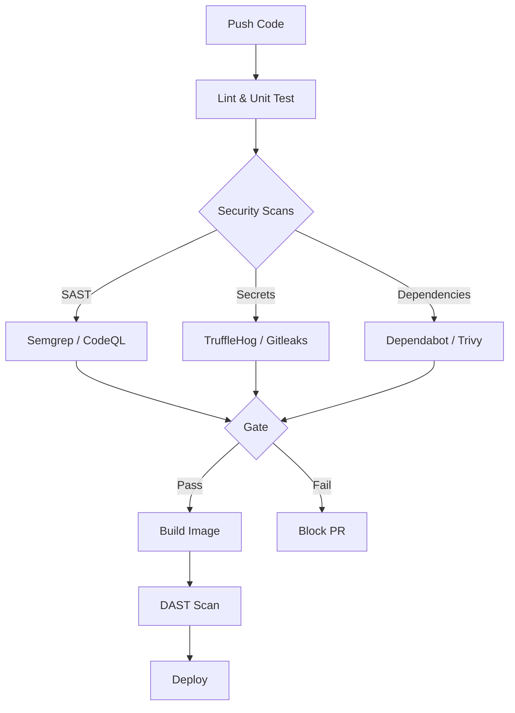

# DevSecOps: Automated Security Scanning

## Purpose
Embed security directly into CI/CD pipelines to catch vulnerabilities early (shift-left). Covers Static Application Security Testing (SAST), Dynamic Application Security Testing (DAST), dependency scanning, and secret scanning, with explicit pass/fail gates that block merges on verified findings.

## Agent Protocol

### Trigger
User phrases: "DevSecOps pipeline", "shift-left security", "add SAST to CI", "secret scanning in CI", "security gate".

### Input Context
- CI platform (GitHub Actions, GitLab CI, etc.) and languages in the repo.
- Which scan classes are required and the gating policy.

### Output Artifact
A pipeline definition with scan stages and a gate. No secrets committed.

### Response Format
```
Stage: {sast|dast|secrets|deps}
Tool: {Semgrep | TruffleHog | Trivy | ...}
Gate: {block on verified/high | warn}
```

## Pipeline Architecture



## GitHub Actions Example (SAST & Secrets)

```yaml
name: DevSecOps Pipeline
on: [push, pull_request]

jobs:
  security-scans:
    runs-on: ubuntu-latest
    steps:
      - name: Checkout Code
        uses: actions/checkout@v4

      - name: Secret Scanning (TruffleHog)
        uses: trufflesecurity/trufflehog@main
        with:
          path: ./
          base: ${{ github.event.repository.default_branch }}
          head: HEAD
          extra_args: --only-verified

      - name: SAST Scanning (Semgrep)
        # The legacy returntocorp/semgrep-action is deprecated; run `semgrep ci`
        # from the official package/image instead.
        run: |
          pip install semgrep
          semgrep ci --config p/default
        env:
          SEMGREP_APP_TOKEN: ${{ secrets.SEMGREP_APP_TOKEN }}
```

> Note: `returntocorp/semgrep-action@v1` is deprecated. Current practice is `semgrep ci` (official `semgrep/semgrep` image or the pip package). Pin third-party actions/images to a release tag or SHA rather than `@main` in production.
