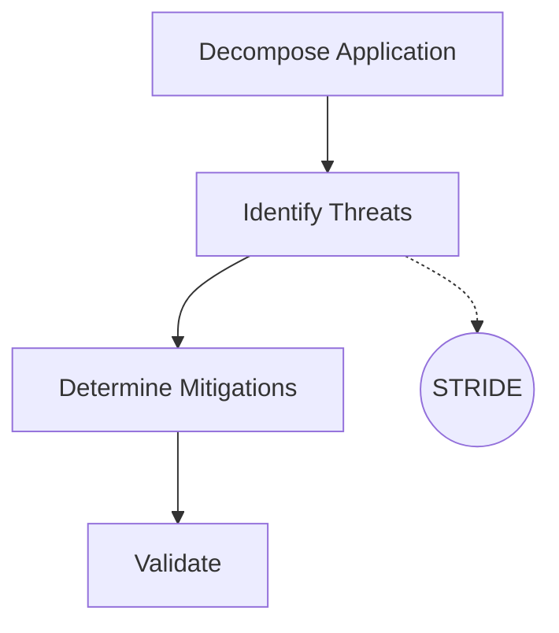

# Threat Modeling (STRIDE)

## Purpose
Identify and mitigate architectural security flaws during the design phase, before any code is written. Decompose the system, enumerate threats with STRIDE across each trust boundary, assign mitigations, and validate — producing a threat model that drives secure design decisions.

## Agent Protocol

### Trigger
User phrases: "threat model this", "STRIDE analysis", "security by design", "data flow diagram", "trust boundaries".

### Input Context
- System/feature architecture and its external interfaces.
- Data sensitivity and compliance constraints.

### Output Artifact
A STRIDE threat table per trust boundary with mitigations and residual risk.

### Response Format
```
Component: {element}
STRIDE threat: {S/T/R/I/D/E}
Mitigation: {control}
Status: {open | mitigated | accepted}
```

## Methodology: STRIDE

*   **S**poofing: Impersonating something or someone else. (Mitigation: Strong Authentication)
*   **T**ampering: Modifying data or code. (Mitigation: Integrity checks, TLS)
*   **R**epudiation: Claiming to have not performed an action. (Mitigation: Secure Logging, Auditing)
*   **I**nformation Disclosure: Exposing information to unauthorized users. (Mitigation: Encryption at rest/transit)
*   **D**enial of Service: Denying or degrading service to users. (Mitigation: Rate limiting, WAF)
*   **E**levation of Privilege: Gaining capabilities without proper authorization. (Mitigation: RBAC, Least Privilege)

## Threat Modeling Process



## Security-by-Design Checklist

- [ ] Data flow diagrams (DFDs) created for all trust boundaries.
- [ ] Authentication and Authorization defined at every entry point.
- [ ] Secrets management strategy established (no hardcoded credentials).
- [ ] Input validation and output encoding strictly enforced.
