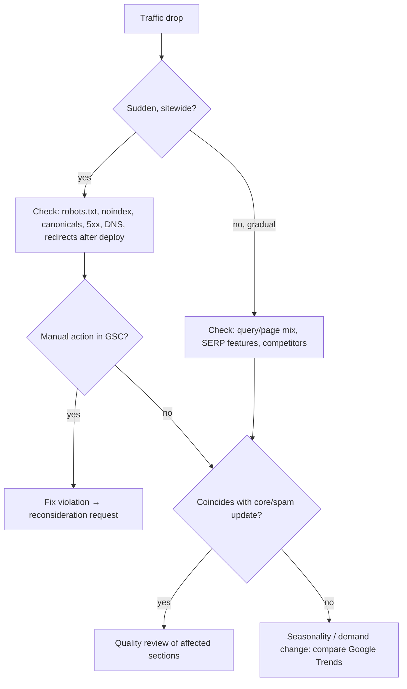

# SEO Fundamentals (Technical & On-Page)

## Purpose
Search visibility depends on three gates in order: the page must be **crawlable**, then **indexable** (and chosen as canonical), then **rankable** (relevant, helpful, fast, trusted). Most "SEO problems" are a failure at gate 1 or 2. This skill audits those gates with Search Console evidence and applies correct directives — many popular SEO rules (`rel=prev/next`, `changefreq`, `Crawl-delay` for Google) no longer do anything.

## Agent Protocol

### Trigger
"seo audit", "not indexed", "crawled - currently not indexed", "robots.txt", "sitemap", "canonical", "noindex", "duplicate content", "redirect", "hreflang", "crawl budget", "traffic drop".

### Input Context
- Search Console data: Page indexing report, URL Inspection results, Performance by page/query, Crawl stats.
- Site size, CMS/framework, rendering mode (SSR/SSG/CSR).
- Recent changes: migrations, redesigns, Google core/spam update dates vs. traffic graph.

### Output Artifact
Prioritised issue list with evidence and exact fixes (headers, tags, config, redirects).

### Response Format
```
Issue: {description}  Gate: {crawl|index|rank}
Evidence: {GSC report / URL Inspection / crawl}
Affected: {URL pattern, count}
Fix: {exact tag/header/config}
Priority: {P0..P3}  Verify: {how to confirm}
```

## Gate 1: Crawling
- `robots.txt` controls **crawling**, not indexing. A disallowed URL can still be indexed (without content) if linked elsewhere.
- Never block CSS/JS needed for rendering.
- Google ignores `Crawl-delay` (Bing honours it). Google adjusts crawl rate automatically; the Search Console crawl-rate limiter was retired in 2024 — return `503`/`429` temporarily if overloaded.
- `robots.txt` is public: do not list secret paths in it; protect them with authentication.

```txt
User-agent: *
Disallow: /admin/
Disallow: /cart
Disallow: /*?sessionid=
Sitemap: https://example.com/sitemap.xml

# Opt out of AI training crawlers if desired (does not affect Google Search ranking)
User-agent: GPTBot
Disallow: /
User-agent: Google-Extended
Disallow: /
```

## Gate 2: Indexing
| Goal | Correct tool |
|------|--------------|
| Keep a page out of the index | `<meta name="robots" content="noindex">` or `X-Robots-Tag: noindex` header — and the page must **not** be blocked in robots.txt, or Google never sees the noindex |
| Consolidate duplicates | `<link rel="canonical" href="absolute-url">` (a strong hint, not a directive) + consistent internal links |
| Private content | Authentication (401/403), not noindex |
| Removed permanently | `404` or `410` |
| Moved | `301`/`308` to the closest equivalent |
| Non-HTML files (PDF) | `X-Robots-Tag` header |

Indexing decision guide:
```
Useful, unique, public?                         → index (self-referencing canonical)
Duplicate/variant (sort, tracking params)?      → canonical to the primary URL
Internal search results, thin filter combos?    → noindex (keep crawlable) or don't link them
Paginated lists (page 2, 3, ...)?               → index each page with self-canonical; link pages normally
                                                  (Google has not used rel=prev/next since 2019)
Thank-you, account, cart pages?                 → noindex or auth
```

Common Search Console statuses:
| Status | Meaning | Action |
|--------|---------|--------|
| Discovered – currently not indexed | Known but not crawled yet | Improve internal linking, site quality; check server capacity |
| Crawled – currently not indexed | Crawled, judged not worth indexing (yet) | Improve uniqueness/value or consolidate |
| Duplicate, Google chose different canonical | Your canonical hint was overridden | Align canonical, redirects, internal links, sitemap on one URL |
| Alternate page with proper canonical tag | Working as intended | None |
| Soft 404 | Page looks empty/error but returns 200 | Return real 404 or add content |

## Sitemaps
- Max 50,000 URLs or 50 MB (uncompressed) per file; use a sitemap index beyond that.
- List only canonical, indexable, 200-status URLs.
- Google uses `<lastmod>` when it is consistently accurate; it ignores `<changefreq>` and `<priority>`.
- Submit in Search Console and reference from `robots.txt`.

```ts
// build-sitemap.ts
const escapeXml = (s: string) =>
  s.replace(/&/g, '&amp;').replace(/</g, '&lt;').replace(/>/g, '&gt;').replace(/"/g, '&quot;').replace(/'/g, '&apos;');

export function buildSitemap(pages: { url: string; lastModified: Date }[]): string {
  if (pages.length > 50_000) throw new Error(`Sitemap has ${pages.length} URLs; split into multiple files`);
  const urls = pages
    .map((p) => `  <url><loc>${escapeXml(p.url)}</loc><lastmod>${p.lastModified.toISOString()}</lastmod></url>`)
    .join('\n');
  return `<?xml version="1.0" encoding="UTF-8"?>\n<urlset xmlns="http://www.sitemaps.org/schemas/sitemap/0.9">\n${urls}\n</urlset>`;
}
```
`lastModified` must come from real content change times, never `new Date()` at build time.

## Redirects
- Google treats `301`/`308` (permanent) and `302`/`307` (temporary) as passing signals; permanent ones tell Google to swap the canonical to the target. Use permanent for moves.
- Avoid chains (> 1 hop) and loops; update internal links to final URLs.
- Site migrations: one-to-one URL map, redirects live at launch, keep them at least a year, use the Change of Address tool for domain moves.

## Rendering
- Server-render or statically generate pages that need to rank. Google renders JavaScript, but rendering is deferred and other crawlers (and many AI crawlers) may not run JS.
- Links must be `<a href>` elements; `onClick` navigation is not followed.
- Dynamic rendering (serving bots a different prerendered version) is described by Google as a workaround, not a recommended solution.

## International (hreflang)
```html
<link rel="alternate" hreflang="en-us" href="https://example.com/en-us/pricing" />
<link rel="alternate" hreflang="de-de" href="https://example.com/de-de/preise" />
<link rel="alternate" hreflang="x-default" href="https://example.com/pricing" />
```
- Every version lists all versions including itself (bidirectional), each with a self-canonical.
- Language codes ISO 639-1, optional region ISO 3166-1 alpha-2 (`en-gb`, not `en-uk`).
- Do not force IP-based redirects; offer a language switcher.

## On-Page Basics
- One descriptive `<title>` per page, unique, front-loading the topic; Google truncates by pixel width (roughly 50-60 characters visible) and may rewrite titles.
- Meta description: unique summary that earns the click; not a ranking factor and may be rewritten.
- One clear `<h1>` matching the page topic; logical heading hierarchy.
- Descriptive URLs, lowercase, hyphens; avoid parameters for indexable content.
- Images: descriptive `alt`, descriptive filenames, `width`/`height`.
- Internal links with descriptive anchor text; important pages within a few clicks of the homepage.

## Ranking Factors Worth Your Time
- Helpful, original content matching intent (see seo-ai-content-optimization).
- Page experience: HTTPS, mobile-friendly, Core Web Vitals (a tie-breaker-level signal, see web-performance), no intrusive interstitials.
- Links from relevant, reputable sites; avoid paid/unnatural links (mark sponsored links `rel="sponsored"`, UGC `rel="ugc"`).
- Topical depth: pillar page + supporting pages interlinked.

## Traffic Drop Triage


## Anti-patterns
| Anti-pattern | Fix |
|--------------|-----|
| `Disallow` + `noindex` on same URL | Allow crawling so noindex is seen |
| Canonical pointing to a noindexed or redirected URL | Canonical → final 200 indexable URL |
| `rel=prev/next` as the pagination fix | Self-canonical paginated pages, crawlable links |
| Sitemap `lastmod` = build time | Real modification dates |
| Client-side-only rendered content and links | SSR/SSG, real `<a href>` |
| Keyword-stuffed titles/content | Write for intent |
| Mass 302s during a migration "to be safe" | Permanent redirects with a URL map |

## Checklist
- [ ] robots.txt allows rendering resources; no secret paths listed.
- [ ] Indexing directives consistent (noindex pages crawlable; canonicals to 200 URLs).
- [ ] Sitemaps contain only canonical indexable URLs with real lastmod.
- [ ] No redirect chains; internal links point to final URLs.
- [ ] SEO-critical pages server-rendered with crawlable links.
- [ ] hreflang bidirectional with x-default (if multi-locale).
- [ ] Search Console reports reviewed monthly; alerts on indexing drops.

## References
- `references/seo-fundamentals.md`
