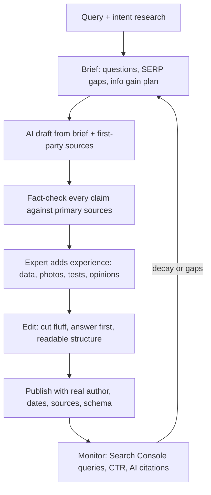

# AI-Assisted Content & SEO

## Purpose
Google's stated position is that it rewards helpful, reliable, people-first content regardless of how it is produced, and penalises content produced primarily to manipulate rankings. Its **scaled content abuse** spam policy (March 2024) targets mass-produced low-value pages whether made by AI, humans or both. This skill defines a workflow that uses LLMs for speed while adding the experience, accuracy and originality that ranking and AI-search citation depend on.

## Agent Protocol

### Trigger
"AI content", "ChatGPT articles SEO", "E-E-A-T", "helpful content", "scaled content abuse", "AI Overviews", "GEO", "content refresh with AI".

### Input Context
- Site topic and YMYL exposure (health, finance, legal, safety → higher scrutiny).
- Available first-party assets: data, experts, product usage, customer cases.
- Volume goals and current editorial capacity.

### Output Artifact
Editorial pipeline, brief template, prompt template, QA checklist; optionally a rewritten article outline.

### Response Format
```
Page intent: {query + user task}
Information gain: {what we add that others lack}
Author/expert: {who, credentials, first-hand experience}
AI role: {outline|draft|summarize|translate}
Human role: {fact-check, experience, edit, sign-off}
Disclosure: {byline + how AI was used, if relevant}
```

## Policy Facts to Design Around
- **E-E-A-T** (Experience, Expertise, Authoritativeness, Trustworthiness) comes from Google's Search Quality Rater Guidelines; raters do not directly rank pages, but the guidelines describe what ranking systems aim to reward. Trust is the most important element.
- **Helpful content**: since March 2024, helpfulness signals are part of core ranking systems, not a separate classifier.
- **Spam policies** relevant to AI: scaled content abuse, site reputation abuse (third-party pages exploiting a host site's signals), expired domain abuse.
- AI use disclosure: Google suggests explaining "who, how and why" where readers would reasonably want to know; accurate author bylines matter more than labelling tools.

## Pipeline



## Brief Template
```text
Primary query: {query}        Intent: {know|do|compare|buy}
Reader: {who, what they already know}
Must answer (from SERP + People Also Ask + support tickets): {questions}
Information gain: {original data, test results, screenshots, expert quote, cost table}
Sources allowed: {primary docs, our data} — no unsourced statistics
Outline: H2/H3 with the direct answer in the first 2 sentences of each section
Expert reviewer: {name, credential}
```

## Prompt Template for the Draft
```text
You are drafting for {site}, audience: {reader}. Use ONLY the facts in <sources>.
If a fact is not in <sources>, write [NEEDS SOURCE] instead of inventing it.
Follow this outline exactly: {outline}.
Start each section with a direct 1-2 sentence answer, then detail.
Mark places where first-hand experience is needed with [EXPERT: what to add].
Write plainly; no filler intros, no "in today's fast-paced world".
<sources>{pasted primary material, our data}</sources>
```
`[NEEDS SOURCE]` and `[EXPERT: ...]` markers must all be resolved before publishing (enforce in CMS or CI with a text check).

## On-Page Structure That Gets Cited
AI search features (Google AI Overviews/AI Mode, ChatGPT search, Perplexity, Copilot) quote passages that answer a question cleanly. Normal SEO hygiene is the lever — there is no special markup for them:
- Question-shaped headings with a self-contained answer right below.
- Concrete numbers with source links and dates; comparison tables.
- Original data and named experts (citable, hard to replicate).
- Crawlable HTML (not text in images or client-only rendering); allow the relevant crawlers in `robots.txt` if you want to appear (e.g. `OAI-SearchBot` for ChatGPT search; `Google-Extended` controls Gemini model use, not Search inclusion).
- `llms.txt` is a community proposal; no major search engine has committed to using it, so treat it as optional.

## Quality Gates (block publish if any fail)
| Gate | Check |
|------|-------|
| Accuracy | Every statistic/claim has a primary source link; numbers re-verified |
| Originality | At least one element competitors lack (data, test, expert insight, example) |
| Experience | Real author bio with relevant credentials; first-hand details present |
| Usefulness | Answers the query in the first screen; no padding to hit word counts |
| Duplication | Not substantially similar to existing pages on our site (cannibalisation) |
| YMYL | Medical/financial/legal reviewed by qualified reviewer, review date shown |

## Scaling Safely
- Throughput limit = editor and expert capacity, not generation capacity.
- Prefer updating and consolidating existing pages over publishing near-duplicates.
- Noindex or remove pages with no traffic and no unique value after a review window.
- Track per-page: impressions, clicks, average position, engagement; investigate sitewide drops after core updates.

## Anti-patterns
| Anti-pattern | Fix |
|--------------|-----|
| Publishing raw LLM output at volume | Editorial pipeline with gates |
| Fake author personas | Real, accountable authors |
| Keyword-stuffed prompts ("use keyword 15 times") | Write for intent; natural language |
| Unsourced statistics from the model | `[NEEDS SOURCE]` policy, primary sources only |
| Rewriting competitors' articles | Add information gain or don't publish |

## Checklist
- [ ] Brief with information-gain plan exists for every piece.
- [ ] Draft constrained to provided sources; markers resolved.
- [ ] Fact-check, expert review and editor sign-off recorded.
- [ ] Real byline, publish/update dates, sources listed.
- [ ] Performance reviewed and stale content refreshed or pruned.
