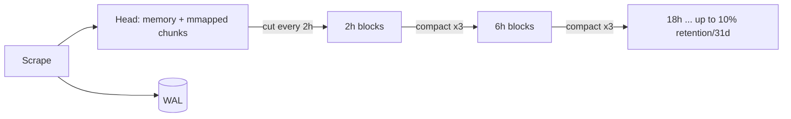

# Observability at Scale: Prometheus TSDB and Beyond

## Purpose
Metrics systems fail at scale because of active series count (memory), churn, and query fan-out, not raw sample volume. Understanding the TSDB's head block, WAL, and compaction explains Prometheus memory behaviour and when to shard or move to a horizontally scalable backend.

## Agent Protocol

### Trigger
"prometheus tsdb", "compaction", "prometheus memory", "high cardinality", "scale prometheus", "thanos vs mimir", "remote write tuning", "retention", "too many series", "otel collector scaling".

### Input Context
- Active series (`prometheus_tsdb_head_series`), ingestion rate (`rate(prometheus_tsdb_head_samples_appended_total[5m])`), churn.
- Retention needs, HA requirements, query patterns (dashboards vs long-range).
- Multi-cluster/tenant topology.

### Output Artifact
Diagnosis, config changes, architecture recommendation. No file unless requested.

### Response Format
```
Load: {active series, samples/s, churn}
Bottleneck: {head memory|cardinality|query fan-out|remote write lag|disk}
Fix: {relabel/drop, recording rules, shard, remote storage}
Config: {snippet}
```

### Completion Criteria
- [ ] Top cardinality offenders identified by metric and label.
- [ ] Changes measured via TSDB metrics before/after.

## TSDB Internals
- **Head block (in memory):** recent samples for every active series, plus the in-memory inverted index. Completed chunks (120 samples or chunk time range) are written to disk as memory-mapped head chunks, reducing resident memory.
- **WAL:** every append written to a write-ahead log (128 MiB segments) for crash recovery; replayed on startup (long replays on big heads — slow restarts). WAL compression is on by default.
- **Persistent blocks:** the head is cut into immutable blocks covering 2 hours once it spans ~3 hours (1.5× block range), keeping recent data in memory for queries.
- **Compaction:** adjacent blocks are merged into larger ones with ranges growing by a factor of 3 (2h → 6h → 18h → 54h ...), capped at 10% of the retention time or 31 days, whichever is smaller. Compaction also applies tombstones (deletes) and deduplicates index entries.
- **Block contents:** `chunks/` (compressed samples: Gorilla-style delta-of-delta timestamps and XOR values), `index` (symbol table, postings lists mapping label pairs → series IDs, series → chunk refs), `meta.json`, `tombstones`.
- **Query path:** label matchers → postings intersection → series → chunks. Regex matchers on high-cardinality labels and wide time ranges touch more postings and chunks.



## Sizing Rules of Thumb
- Memory is dominated by active series count and label size; budget a few KiB per active series for head + index (measure your own: `process_resident_memory_bytes / prometheus_tsdb_head_series`).
- Disk ≈ retention seconds × samples/s × ~1–2 bytes per sample (compressed), plus WAL.
- Churn (series created and abandoned, e.g. pod names in short-lived Jobs) costs like active series until compacted out of the head.

## Cardinality Control
```promql
# Top metrics by series count
topk(10, count by (__name__) ({__name__=~".+"}))
```
Also use the Prometheus UI **TSDB Status** page (`/tsdb-status`) or `promtool tsdb analyze <data-dir>` for label-value counts.
```yaml
scrape_configs:
  - job_name: app
    kubernetes_sd_configs: [{ role: pod }]
    sample_limit: 50000            # fail scrape instead of OOMing Prometheus
    label_limit: 30
    metric_relabel_configs:
      - source_labels: [__name__]
        regex: "http_server_request_duration_seconds_bucket"
        action: keep               # example: keep only needed families from a noisy target
      - regex: "request_id|user_id|session_id"
        action: labeldrop          # unbounded labels never belong in metrics
```
Native histograms (stable since Prometheus 3.8; enable per job with `scrape_native_histograms: true`, which requires the protobuf scrape protocol) replace dozens of `_bucket` series with one series per histogram. Set `always_scrape_classic_histograms: true` during migration if dashboards still use `_bucket`.

## Recording Rules
Precompute expensive aggregations used by dashboards/alerts (`job:http_requests:rate5m`). Keep recording-rule outputs low-cardinality.

## Scaling Options
| Approach | How | Fit |
|---|---|---|
| Functional sharding | Separate Prometheus per team/cluster/domain | Simple; no global view without federation |
| Hash-mod sharding | `hashmod` relabel across N replicas | Large single-target sets |
| HA pairs | Two identical Prometheus + dedup downstream | Availability |
| Thanos | Sidecar uploads 2h blocks to object storage; Querier fans out; Store Gateway serves history; Compactor downsamples | Keep Prometheus, add global view + long retention |
| Grafana Mimir / Cortex | Prometheus (or Agent/Alloy) remote_write → distributed ingesters, object storage | Multi-tenant, very large scale, central ops team |
| VictoriaMetrics | Single-node or cluster, remote_write compatible | Resource-efficient alternative |

## Remote Write Tuning
```yaml
remote_write:
  - url: https://mimir.example.com/api/v1/push
    queue_config:
      capacity: 10000
      max_shards: 50
      max_samples_per_send: 2000
      batch_send_deadline: 5s
    write_relabel_configs:
      - source_labels: [__name__]
        regex: "go_.*|process_.*"
        action: drop
```
Watch `prometheus_remote_storage_highest_timestamp_in_seconds` vs `prometheus_remote_storage_queue_highest_sent_timestamp_seconds` for lag, and `..._samples_failed_total`. Prometheus 3 supports Remote-Write 2.0 (string interning, metadata, native histograms).

## Telemetry Pipeline (OTel Collector) Scaling
- Agent (DaemonSet) → gateway (Deployment) pattern; `memory_limiter` first, `batch` last.
- Stateful processors (tail sampling, span metrics) need trace-ID-aware load balancing (`loadbalancing` exporter).
- Scale gateways on queue size / refused spans, not CPU only.

## Anti-Patterns
- User IDs, request IDs, full URLs, or error messages as label values.
- One Prometheus scraping everything with 6-month local retention.
- Dashboards with `rate(...[1d])` over thousands of series on every refresh.
- Increasing memory limits repeatedly instead of finding cardinality sources.

## Checklist
- [ ] `sample_limit`/`label_limit` on scrape jobs.
- [ ] Weekly top-cardinality review; labeldrop for unbounded labels.
- [ ] Recording rules for heavy dashboard queries.
- [ ] Scaling path chosen (sharding vs Thanos vs Mimir) with object storage retention.
- [ ] Alerts on head series growth, WAL corruption, remote write lag, failed compactions.

## References
- `../references/promql_rules.md`
- `../references/capacity_planning.md`
- Related skill: `skills/cloud-native/distributed-tracing/SKILL.md`.
