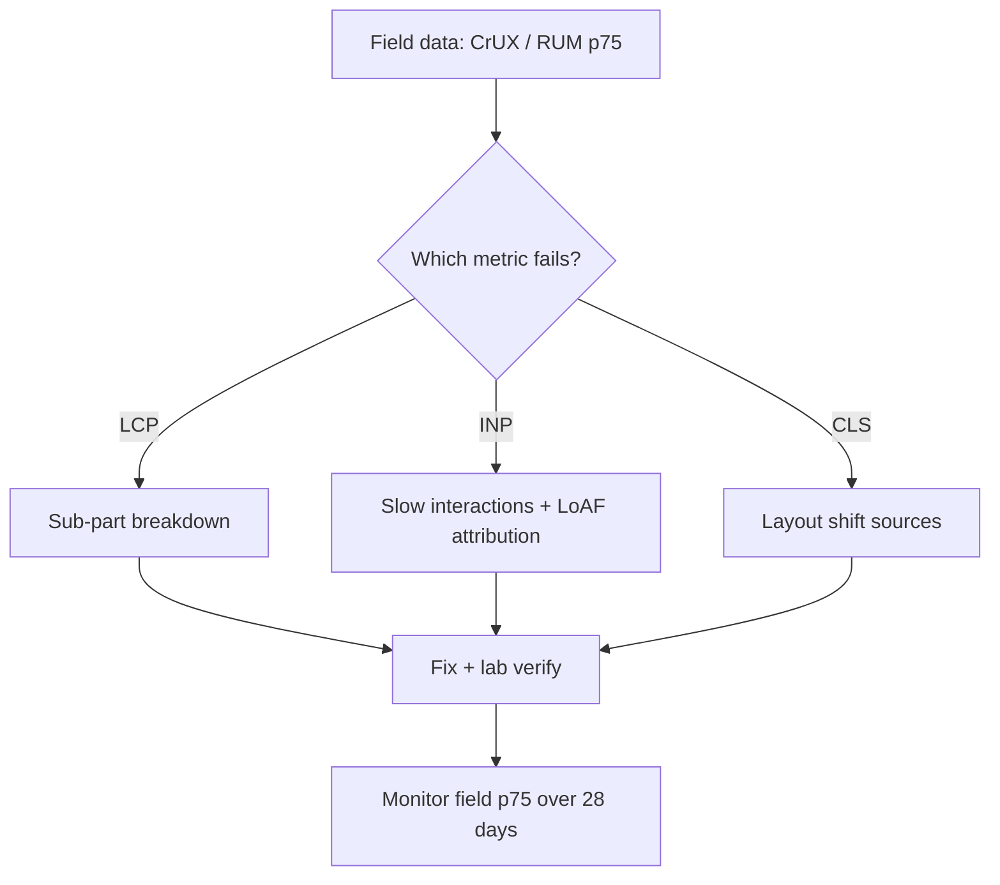

# Web Performance: Core Web Vitals

## Purpose
Core Web Vitals are Google's user-centric metrics, evaluated at the 75th percentile of real-user (field) page loads: **LCP** (loading), **INP** (responsiveness; replaced FID in March 2024) and **CLS** (visual stability). This skill measures them correctly and applies the fixes that move each metric.

## Agent Protocol

### Trigger
"core web vitals", "LCP", "INP", "CLS", "lighthouse", "PageSpeed Insights", "CrUX", "long task", "slow page", "layout shift".

### Input Context
- Field data (CrUX/PageSpeed Insights/RUM) per page template and device class.
- Lab traces (Chrome DevTools Performance panel, Lighthouse).
- Stack (SSR/SPA, framework, CDN) and third-party scripts.

### Output Artifact
Prioritised findings per metric with code/config fixes and expected effect.

### Response Format
```
Page/template: {url pattern}  Device: {mobile|desktop}
Metric: {LCP|INP|CLS} p75={value} target={threshold}
Breakdown: {sub-parts}
Root cause: {...}
Fix: {code/config}
Verify: {lab check + field metric to watch}
```

## Thresholds (p75)
| Metric | Good | Needs improvement | Poor |
|--------|------|-------------------|------|
| LCP | ≤ 2.5 s | ≤ 4.0 s | > 4.0 s |
| INP | ≤ 200 ms | ≤ 500 ms | > 500 ms |
| CLS | ≤ 0.1 | ≤ 0.25 | > 0.25 |

Field data decides; Lighthouse is a lab diagnostic (it cannot measure INP — use Total Blocking Time as a lab proxy).

## Measure in the Field

```ts
import { onLCP, onINP, onCLS, type Metric } from 'web-vitals/attribution';

function send(metric: Metric) {
  const body = JSON.stringify({
    name: metric.name,
    value: metric.value,
    rating: metric.rating,
    id: metric.id,
    page: location.pathname,
    attribution: metric.attribution, // e.g. LCP element/subparts, INP target + long frames
  });
  if (!navigator.sendBeacon('/rum', body)) {
    void fetch('/rum', { method: 'POST', body, keepalive: true });
  }
}

onLCP(send);
onINP(send);
onCLS(send);
```

## LCP
Break LCP into sub-parts (the `web-vitals` attribution build reports them): **TTFB → resource load delay → resource load duration → element render delay**.

| Sub-part too large | Fix |
|--------------------|-----|
| TTFB | CDN/edge caching, avoid redirects, stream HTML, faster server/DB |
| Load delay | Make the LCP image discoverable in HTML (no JS-injected or CSS background hero); `fetchpriority="high"`; never `loading="lazy"` on it |
| Load duration | Right-size with `srcset`/`sizes`, AVIF/WebP, preconnect to image CDN |
| Render delay | Remove render-blocking CSS/JS, avoid client-only rendering of hero, font `font-display` |

```html
<link rel="preconnect" href="https://img.example-cdn.com" crossorigin>

```
Use `<link rel="preload" as="image" imagesrcset=... imagesizes=...>` only when the image cannot be in the initial HTML.

## INP
INP = input delay + processing time + presentation delay for the slowest interactions (roughly the worst, ignoring outliers on pages with many interactions).

- Break long tasks (> 50 ms). Yield to the main thread between chunks:

```ts
function yieldToMain(): Promise<void> {
  const s = (globalThis as { scheduler?: { yield?: () => Promise<void> } }).scheduler;
  if (s?.yield) return s.yield();          // continuation keeps priority where supported
  return new Promise((resolve) => setTimeout(resolve, 0));
}

export async function processItems<T>(items: T[], work: (item: T) => void): Promise<void> {
  let deadline = performance.now() + 50;
  for (const item of items) {
    work(item);
    if (performance.now() > deadline) {
      await yieldToMain();
      deadline = performance.now() + 50;
    }
  }
}
```
- In event handlers, update the UI first, defer non-visual work (analytics, saving) until after the next paint.
- Avoid layout thrashing (reading layout after writing styles in a loop).
- Large DOM (thousands of nodes) inflates presentation delay: virtualise long lists, use `content-visibility: auto` for offscreen sections.
- In React use transitions for expensive re-renders; move CPU-heavy work to Web Workers.
- Audit third-party scripts with the Long Animation Frames API (`PerformanceObserver` type `long-animation-frame`) attribution.

## CLS
| Cause | Fix |
|-------|-----|
| Images/video/iframes without dimensions | `width`/`height` attributes or `aspect-ratio` |
| Ads/embeds injected late | Reserve space with `min-height` per slot |
| Web fonts swapping metrics | `font-display: optional` or metric-matched fallbacks (`size-adjust`, `ascent-override`) |
| Content inserted above existing content | Insert below, or on user interaction (shifts within 500 ms of input are excluded) |
| Animating `top`/`height` | Animate `transform`/`opacity` |

Ensure pages are eligible for the back/forward cache (no `unload` handlers, avoid `Cache-Control: no-store` where possible) — bfcache restores are near-instant and improve all three metrics.

## Workflow



## Anti-patterns
| Anti-pattern | Fix |
|--------------|-----|
| Optimising Lighthouse score only | Track field p75 by template and device |
| Lazy-loading the hero image | Eager + `fetchpriority="high"` |
| Preloading many resources | Preload only the LCP resource/critical font |
| Hiding the page until JS loads (anti-flicker A/B snippets) | Server-side experiments |
| `setTimeout(0)` loops without measuring | Profile, then chunk with deadlines |

## Checklist
- [ ] RUM collects LCP/INP/CLS with attribution per template.
- [ ] LCP element known per template and discoverable in HTML.
- [ ] No long tasks > 50 ms in key interactions; third-party impact audited.
- [ ] All media/embeds reserve space; fonts don't shift layout.
- [ ] Pages bfcache-eligible.
- [ ] Performance budgets enforced in CI (Lighthouse CI or bundle size limits).
